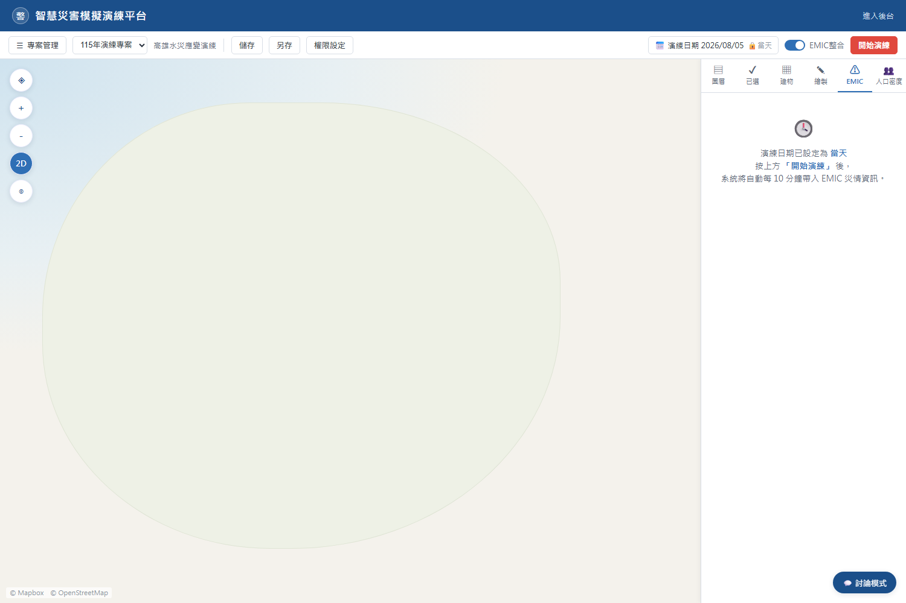
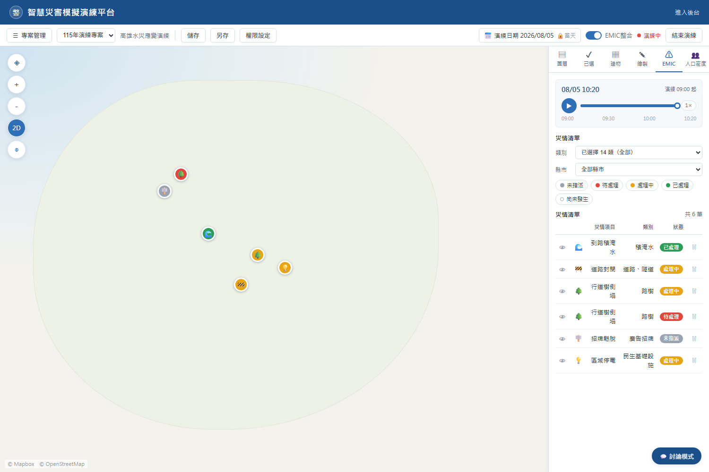
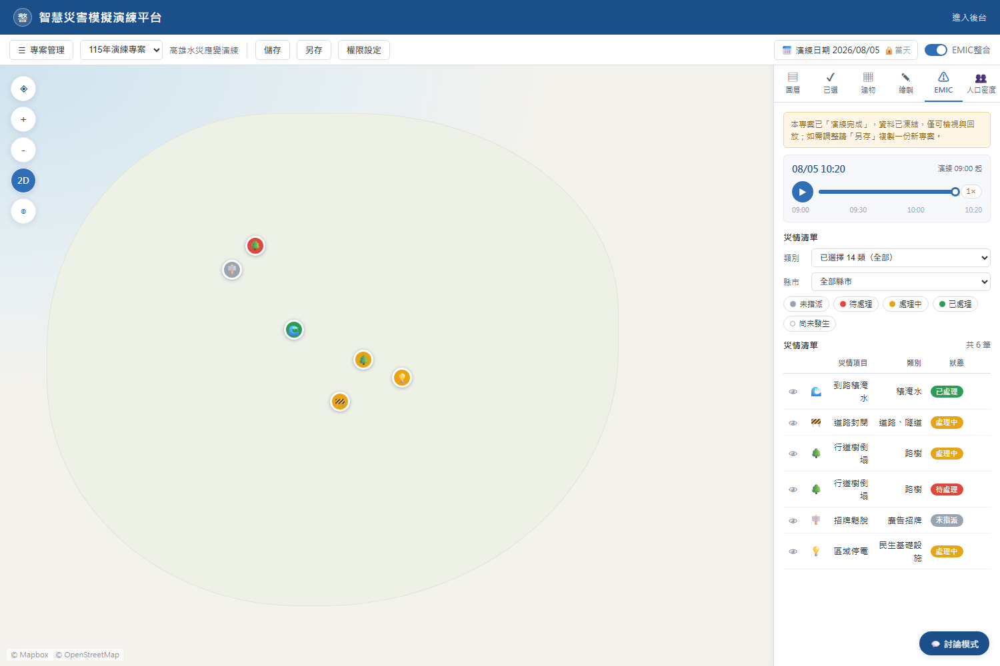

# EMIC 災情整合模組 需求規格 v2
> 依據雛型：02_雛型/雛型_v2_EMIC災情.html（2026-08-05）｜上游：01_需求整理/（需求摘要 + 確認紀錄/確認_20260805_技術主管.md）
> 資料源規格依據：memory/外部系統介接方式_TERIA_EMIC.md（EMIC 演練區 API 定案版）
> 狀態：草稿（待 PM 審）　｜　PM：evieliu@richitech.com.tw
> 合約定位：合約六大工作項目①（災害模擬演練展示平台）之「EMIC 整合」，合約內，階段別 115/10/10 第三階段

## 版本紀錄
| 版本 | 日期 | 依據雛型 | 主要異動 |
|------|------|----------|----------|
| v2 | 2026-08-05 | v2 | 首次產出。依 v2 雛型抽取；Q-01（分頁機制／效能／逾時處理）已由技術主管確認銷案並納入 BR-10 與例外流程。 |

---

## 一、功能概述

EMIC 災情整合模組是「智慧災害模擬演練平台」前台右側的「EMIC」頁籤。一場演練開始後，系統自動每 10 分鐘向消防署 EMIC **演練區** API 取回真實災情任務與其處理狀態，在地圖上以 14 類災情圖徵（顏色代表處理狀態）呈現點位，並提供時間播放器回放整場演練期間災情處理狀態的時序變化，作為教學演練與事後檢討的素材。

**核心限制（設計前提）**：EMIC 無「處理歷程 API」，單次查詢只能取得當下狀態快照。故「時序變化」不由 EMIC 提供，而由本系統在演練期間**自行累積**——每 10 分鐘比對一次，只記錄狀態有變更的時間點。

**User Story**
- US-01 身為情境設定員，我要開始演練後系統自動帶入 EMIC 真實災情，以便不必手動輸入就有演練素材。（F-01、F-02）
- US-02 身為演練人員，我要在地圖上一眼看出各災情的類型與處理狀態，以便掌握全局。（F-04）
- US-03 身為演練檢討者，我要拖拉時間軸回看災情處理狀態怎麼隨時間演變，以便做事後檢討。（F-03、F-05）
- US-04 身為情境設定員，我要篩選、開關或刪除某些災情點位並存進專案，以便聚焦要演練／檢討的災情。（F-06、F-07、F-08）
- US-05 身為情境設定員，我要演練只綁定當天、超過午夜自動收尾，以便演練資料界線清楚。（F-10）

---

## 二、畫面清單
| # | 畫面 | 雛型檔案 | 截圖 | 用途 |
|---|------|----------|------|------|
| 3.1 | EMIC 頁籤 — 演練前（待演練） | 雛型_v2_EMIC災情.html?sc=pre | 畫面截圖/EMIC_演練前.png | 尚未開始演練時的引導 |
| 3.2 | EMIC 頁籤 — 演練中 | 雛型_v2_EMIC災情.html?sc=mid | 畫面截圖/EMIC_演練中.png | 主畫面：地圖點位＋時間播放器＋災情清單＋篩選 |
| 3.3 | 災情點位詳情彈窗 | 雛型_v2_EMIC災情.html（點地圖點位或清單列） | 併於 EMIC_演練中.png | 單一災情全欄位＋附件 |
| 3.4 | EMIC 頁籤 — 演練完成（唯讀） | 雛型_v2_EMIC災情.html?sc=done | 畫面截圖/EMIC_演練完成唯讀.png | 專案凍結後僅檢視與回放 |

---

## 三、畫面規格

### 3.1 EMIC 頁籤 — 演練前（待演練）

**欄位表**
| 元素 | 欄位名 | 型別 | 必填 | 驗證規則 | 預設值 | 資料來源 | 互動行為 | F-編號 |
|------|--------|------|------|----------|--------|----------|----------|--------|
| 演練日期 | drillDate | 日期（單一，非起迄） | 是 | 鎖定系統當天，不可改為其他日期；只設到日期、不設起迄時間 | 系統今日 | 系統時鐘 | 唯讀顯示今日 | F-01 |
| 開始演練 按鈕 | btnStart | 按鈕 | — | 專案＝待演練時可按 | — | — | 按下→專案轉「演練中」、啟動每 10 分鐘取災情、切到 3.2 畫面 | F-01 |
| 演練前提示 | — | 文字 | — | — | — | — | 顯示引導文字，不顯示任何災情 | F-01 |

**業務規則**
- BR-01（F-01）演練日期只能為**當天**：頂部時間選擇器由既有系統的「起迄兩個時間」**簡化為單一區塊、僅設定到日期**，並鎖定系統當日。
- BR-02（F-01）專案＝「待演練」且尚未按「開始演練」前，EMIC 面板不顯示任何災情，僅顯示引導提示。

**例外流程與錯誤訊息**
| 情境 | 系統行為 | 訊息文字（實際文案） |
|------|----------|----------------------|
| 專案＝待演練、尚未開始 | 不取災情、不畫點位 | 「演練日期已設定為當天。按上方『開始演練』後，系統將自動每 10 分鐘帶入 EMIC 災情資訊。」 |

---

### 3.2 EMIC 頁籤 — 演練中

**欄位表**
| 元素 | 欄位名 | 型別 | 必填 | 驗證規則 | 預設值 | 資料來源 | 互動行為 | F-編號 |
|------|--------|------|------|----------|--------|----------|----------|--------|
| 結束演練 按鈕 | btnEnd | 按鈕 | — | 專案＝演練中時顯示 | — | — | 按下→二次確認後專案轉「演練完成」並凍結 | F-01、F-10 |
| 演練中指示 | runDot | 狀態燈 | — | — | — | 專案狀態 | 演練中顯示紅點「演練中」 | F-01 |
| 時間播放器-目前時間 | playNow | 時間 | — | 範圍＝演練開始～最新取得時間 | 最新時間 | 播放器狀態 | 顯示目前回放時間點 | F-05 |
| 時間播放器-播放/暫停 | btnPlay | 按鈕 | — | — | — | — | 按下→自動每 10 分鐘刻度前進回放；再按暫停 | F-05 |
| 時間播放器-時間軸 | track | 拖拉軸 | — | 對齊 10 分鐘刻度 | 最新時間 | 狀態變更時間戳 | 拖拉→跳至該時間點重建狀態 | F-05 |
| 類別 篩選 | fCategory | 複選 | 否 | 14 類災情，可複選 | 全選（14 類） | EMIC 災情類別表 | 篩選地圖與清單 | F-06 |
| 縣市 篩選 | fCounty | 單選 | 否 | 依取得災情涵蓋縣市 | 全部縣市 | EMIC API COUNTY_N | 篩選地圖與清單 | F-06 |
| 狀態 篩選 | fStatus | 複選 | 否 | 未指派／待處理／處理中／已處理＋尚未發生 | 全選 | EMIC CASE_STATUS／CASE_DT | 點圖例切換顯示 | F-06 |
| 災情點位 | marker | 地圖圖徵 | — | ICON 依 14 類災情；顏色依處理狀態 | — | EMIC API | 點擊→開 3.3 詳情；顏色隨播放器時間點變化 | F-04 |
| 災情清單-顯示開關 | eye | 切換 | — | — | 顯示 | — | 點擊切換該點位地圖顯示／隱藏；**開關狀態隨專案儲存** | F-07 |
| 災情清單-類型 | typeIcon | 圖示 | — | 依 14 類 | — | DISASTER_MAIN／SUB_TYPE | 唯讀顯示 | F-04 |
| 災情清單-災情項目 | item | 文字 | — | — | — | EMIC | 點列→定位並開 3.3 詳情 | F-06 |
| 災情清單-類別 | category | 文字 | — | — | — | EMIC | 唯讀顯示 | F-06 |
| 災情清單-狀態 | statusBadge | 標籤 | — | 4 狀態色或「尚未發生」 | — | 依播放器時間點計算 | 唯讀顯示 | F-05、F-06 |
| 災情清單-刪除 | del | 按鈕 | — | 專案＝演練中／情境設定員以上可見 | — | — | 點擊→二次確認後永久移除，**刪除後不存入專案** | F-08 |

**圖徵對應（BR-05）**：14 類災情＝路樹／廣告招牌／道路、隧道／橋梁／鐵路、高鐵捷運／積淹水／土石／建物毀損／水利設施／民生、基礎設施／車輛、交通事故／環境汙染／火災／其他，各一 ICON；每類 × 4 狀態色：**灰＝未指派、紅＝待處理、黃＝處理中、綠＝已處理**（圖徵原稿見 01_需求整理/參考截圖/現有規劃_14類災情圖徵設計.png，與線上製圖模組共用同一套）。

**業務規則**
- BR-03（F-02）演練開始後，系統**每 10 分鐘**呼叫一次 EMIC 演練區 API 取災情與狀態。查詢範圍為**全國、系統自動分批取完**（單次 API 上限 100 筆）。〔技術確認 2026-08-05〕分頁機制由開發者實作。
- BR-04（F-03）**不逐次儲存全快照**（省儲存空間）。每次取回時比對，**只有案件狀態有變更時，才在該案件對應狀態欄位記下該變更的時間點**（例：待處理@09:10 → 處理中@09:30 → 已處理@10:10）。
- BR-05（F-05）**播放器在時間點 T 的呈現**：對每一案件，取其狀態變更時間戳中「時間 ≤ T 的最後一筆」作為該點位在 T 的狀態顏色；案件發生時間（CASE_DT）> T 者視為「**尚未發生**」，地圖不顯示、清單狀態欄顯示「尚未發生」。
- BR-06（F-04）點位圖徵＝14 類 ICON × 4 狀態色（見上方圖徵對應）。
- BR-07（F-06）篩選：災情類別**可複選**、縣市（單選）、災情狀態**可複選**（含「尚未發生」）；篩選同時作用於地圖點位與清單。
- BR-08（F-07）點位眼睛＝地圖**顯示／隱藏**；**開關狀態隨專案儲存**，重開專案沿用。隱藏 ≠ 刪除，資料仍在專案內。
- BR-09（F-08）點位刪除＝二次確認後**永久移除**該災情；**被刪除的災情不會出現在專案、也不會被儲存、無法回放**（與眼睛隱藏的根本差別）。
- BR-10（F-02）〔技術確認 2026-08-05〕效能受 EMIC 端影響、我方較不可控；API 逾時／無回應時**加重試機制**；重試仍失敗導致的狀態歷程缺漏，屬 EMIC API 本身限制，**客戶（老師）已表示可接受**。重試次數／間隔屬開發實作細節，本規格不定義（見附錄 B）。

**例外流程與錯誤訊息**
| 情境 | 系統行為 | 訊息文字（實際文案） |
|------|----------|----------------------|
| 此時間點／篩選條件下無災情 | 清單顯示空狀態、地圖無點位 | 「此時間點／篩選條件下無災情」 |
| 點刪除（🗑） | 先跳二次確認，取消則不刪 | 「確定刪除此災情點位『{災情項目}』？刪除後此災情不會存入專案，也無法回放。」 |
| EMIC API 逾時／無回應 | 加重試機制；重試仍失敗則本次略過、下個 10 分鐘再取 | 狀態歷程可能缺漏，屬 EMIC 端限制、客戶已接受〔技術確認 2026-08-05〕；不阻斷演練 |

---

### 3.3 災情點位詳情彈窗
併於 3.2「演練中」畫面（點地圖點位或清單列開啟）。

**欄位表（全欄位對照 EMIC API，型別以 memory/外部系統介接方式_TERIA_EMIC.md 為準）**
| 顯示欄 | EMIC 欄位 | 型別 | 說明 | F-編號 |
|------|-----------|------|------|--------|
| 案件編號 | CASE_ID | string | — | F-09 |
| 發生時間 | CASE_DT | DateTime `yyyy-MM-ddTHH:mm` | 亦作播放器「尚未發生」判定基準 | F-09、F-05 |
| 縣市／鄉鎮 | COUNTY_N／TOWN_N | string | — | F-09 |
| 發生地點 | CASE_LOC | string | — | F-09 |
| 災情類別／項目 | DISASTER_MAIN_TYPE／DISASTER_SUB_TYPE | string | 依 EMIC 災情類別表 | F-09、F-04 |
| 災情描述 | CASE_DESCRIPTION | string | — | F-09 |
| 處理狀態 | CASE_STATUS | string | 未指派／待處理／處理中／已處理 | F-09、F-04 |
| 聯絡人／電話 | peopleName／peoplePhone | string | — | F-09 |
| 受傷／死亡／受困／失蹤／收容人數 | INJURED_NO／DEATH_NO／TRAPPED_NO／MISSING_NO／SHELTER_NO | integer | — | F-09 |
| 交通障礙／重大災情／結案／退水 | IS_TRAFFIC／IS_SERIOUS／IS_CLOSE／IS_RETREAT | string（是／否） | IS_RETREAT 退水狀態僅積淹水災情才有 | F-09 |
| 通報來源 | RPT_SOURCE | string | 依 EMIC 通報來源類別表 | F-09 |
| 幾何型別／坐標 | GEOMETRY_TYPE／COORDINATE | string | 點／線／面；WGS84 經度,緯度 | F-09、F-04 |
| 案件更新時間 | MODIFIED_DT | DateTime | — | F-09 |
| 附件 | FILE_LIST（FILE_TYPE／FILE_URL） | 陣列 | 每筆一個下載連結 | F-09 |

**業務規則**
- BR-11（F-09）詳情內容為 EMIC API 該案件回傳之當下值；附件以 FILE_LIST 的 FILE_URL 提供下載連結。

**例外流程與錯誤訊息**
| 情境 | 系統行為 | 訊息文字（實際文案） |
|------|----------|----------------------|
| 該案件無附件（FILE_LIST 空） | 不顯示附件區塊 | （不顯示，不視為錯誤） |
| 欄位無值（如聯絡人未提供） | 顯示「—」 | — |

---

### 3.4 EMIC 頁籤 — 演練完成（唯讀）

**業務規則**
- BR-12（F-10）演練日期只能為當天；若當天 **23:59** 使用者尚未按「結束演練」，系統**自動視同結束演練**：停止呼叫新災情、專案轉「演練完成」並凍結（非只停呼叫）。
- BR-13（F-11）演練期間取得的災情、狀態變更時間戳、點位眼睛開關狀態，皆**隨專案儲存**；專案「演練完成」後**不可編輯，僅能「另存」複製**一份新專案（沿用既有系統專案 3 狀態機制：待演練／演練中／演練完成）。
- BR-14（F-10）演練完成畫面：顯示唯讀橫幅、隱藏「結束演練」按鈕與各列刪除鈕；時間播放器仍可回放、眼睛仍可切換檢視。

**例外流程與錯誤訊息**
| 情境 | 系統行為 | 訊息文字（實際文案） |
|------|----------|----------------------|
| 當天 23:59 未按結束演練 | 自動停止呼叫、自動視同結束演練、專案轉演練完成並凍結 | （次日開啟時）「本演練已於 23:59 自動結束」 |
| 專案＝演練完成後嘗試編輯 | 阻擋編輯、僅可檢視與回放 | 「本專案已『演練完成』，資料已凍結，僅可檢視與回放；如需調整請『另存』複製一份新專案。」 |

---

## 四、權限與資料範圍
> 角色沿用既有系統 3 級（memory：系統管理者／情境設定員／演練人員）。

| 角色 | 可用操作 | 資料範圍 |
|------|----------|----------|
| 系統管理者 | 全部：設定演練、開始／結束演練、篩選、點位顯示開關、刪除、看詳情、回放 | 全國取回之災情 |
| 情境設定員（專案擁有者，可多人） | 設定演練、開始／結束演練、篩選、點位顯示開關、刪除、看詳情、回放 | 該專案取回之災情 |
| 演練人員（檢視者） | 僅檢視：篩選、看詳情、回放、切換點位顯示（不可刪除、不可開始／結束演練） | 該專案已存之災情 |

- 演練完成專案：對所有角色皆唯讀（見 BR-14），僅可檢視與回放。

---

## 五、非功能需求
- **資料源限制**：EMIC 演練區 API 為「警大_瑞竣」雙方協議專用介接，非公開 API；單次查詢上限 100 筆；Endpoint 與欄位定案版見 memory/外部系統介接方式_TERIA_EMIC.md。
- **取用頻率**：演練中每 10 分鐘一次；警大防災所已接受此頻率造成的時間差／歷程缺失。
- **儲存效能**：不逐次存全快照，僅記狀態變更時間戳，以控制儲存空間（BR-04）。
- **容錯**：API 逾時／無回應加重試；不阻斷演練（BR-10）。
- **相容既有系統**：本模組為既有前台平台「EMIC」右側頁籤；圖台核心 Mapbox、風格與專案儲存機制沿用既有系統。
- **時間邊界**：演練綁定當天、23:59 自動收尾（BR-12）。

---

## 六、驗收條件（AC）— PG 自測與 PM 驗收共用
> PG 交付前逐項自測勾「PG自測」，全勾才交 PM；PM 驗收勾「PM驗收」。
> 不通過的在備註寫清楚現象：是 bug → PG 修復後複測；是需求認知差異或客戶改需求 → 回 /req-intake 從雛型改起。

| AC | 類別 | 對應 F | Given（前置） | When（操作） | Then（預期結果） | PG自測 | PM驗收 | 備註 |
|----|------|--------|---------------|--------------|------------------|--------|--------|------|
| AC-01 | 主流程 | F-01 | 以情境設定員登入、專案＝待演練 | 檢視頂部演練日期 | 演練日期為系統當天、單一日期區塊（無起迄時間）、唯讀不可改 | ☐ | ☐ | |
| AC-02 | 驗證 | F-01 | 專案＝待演練 | 嘗試把演練日期改為其他日期 | 無法變更（鎖定當天） | ☐ | ☐ | |
| AC-03 | 例外 | F-01 | 專案＝待演練、未按開始 | 開啟 EMIC 頁籤 | 不顯示任何災情，顯示「按『開始演練』後，系統將自動每 10 分鐘帶入 EMIC 災情資訊」 | ☐ | ☐ | |
| AC-04 | 主流程 | F-01、F-02 | 專案＝待演練 | 按「開始演練」 | 專案轉「演練中」、顯示「演練中」指示、開始每 10 分鐘取災情 | ☐ | ☐ | |
| AC-05 | 主流程 | F-02 | 演練中 | 等待 10 分鐘週期 | 系統呼叫 EMIC 演練區 API（全國、自動分批取完）取回災情與狀態 | ☐ | ☐ | 分頁由開發實作 |
| AC-06 | 主流程 | F-03 | 演練中、某案件狀態由待處理變處理中 | 系統下一次取回並比對 | 僅在該案件對應狀態欄位新增此變更時間點，不另存整份快照 | ☐ | ☐ | |
| AC-07 | 主流程 | F-04 | 演練中、地圖有災情點位 | 檢視地圖 | 點位 ICON 依 14 類災情、顏色依狀態（灰未指派／紅待處理／黃處理中／綠已處理） | ☐ | ☐ | |
| AC-08 | 主流程 | F-05 | 演練中、某案件經歷 待處理→處理中→已處理 | 拖拉時間軸到 09:15、09:35、10:15 | 該點位顏色分別為紅、黃、綠（依 ≤T 最後一筆狀態） | ☐ | ☐ | |
| AC-09 | 主流程 | F-05 | 演練中、案件發生時間 09:30 | 拖拉時間軸到 09:20 | 該案件視為「尚未發生」：地圖不顯示、清單狀態欄顯示「尚未發生」 | ☐ | ☐ | |
| AC-10 | 主流程 | F-05 | 演練中 | 按播放器「▶」 | 時間軸自動每 10 分鐘刻度前進、點位與清單狀態同步變化；再按暫停即停 | ☐ | ☐ | |
| AC-11 | 主流程 | F-06 | 演練中、含高雄市與臺南市災情 | 縣市篩選選「高雄市」 | 地圖與清單僅顯示高雄市災情 | ☐ | ☐ | |
| AC-12 | 主流程 | F-06 | 演練中 | 災情類別複選「積淹水」「道路、隧道」 | 地圖與清單僅顯示此兩類 | ☐ | ☐ | 類別可複選 |
| AC-13 | 驗證 | F-06 | 演練中 | 狀態圖例關閉「已處理」 | 已處理之點位與清單列隱藏，其餘狀態仍顯示 | ☐ | ☐ | 狀態可複選 |
| AC-14 | 例外 | F-06 | 演練中 | 篩選條件組合到無符合災情 | 清單顯示「此時間點／篩選條件下無災情」、地圖無點位 | ☐ | ☐ | |
| AC-15 | 主流程 | F-07 | 演練中、清單有多筆災情 | 點某列眼睛關閉 | 該點位自地圖隱藏、該列淡化；資料仍在專案內 | ☐ | ☐ | |
| AC-16 | 主流程 | F-07、F-11 | 演練中、已關閉某點位眼睛 | 儲存並重開專案 | 該點位仍為隱藏狀態（開關狀態隨專案儲存） | ☐ | ☐ | |
| AC-17 | 例外 | F-08 | 演練中、情境設定員 | 點某列刪除（🗑） | 跳確認「確定刪除此災情點位『{項目}』？刪除後此災情不會存入專案，也無法回放。」 | ☐ | ☐ | |
| AC-18 | 主流程 | F-08、F-11 | 承 AC-17、按確認刪除後儲存 | 重開專案 | 被刪除的災情不出現、不可回放（與隱藏不同） | ☐ | ☐ | |
| AC-19 | 主流程 | F-09 | 演練中 | 點地圖點位或清單列 | 彈出詳情，含案件編號、發生時間、縣市鄉鎮、地點、類別項目、描述、處理狀態、聯絡人電話、傷亡受困失蹤收容人數、交通／重大／結案／退水、通報來源、坐標、更新時間 | ☐ | ☐ | |
| AC-20 | 主流程 | F-09 | 詳情彈窗、該案件有附件 | 檢視附件區 | 逐一列出 FILE_LIST 附件下載連結；無附件則不顯示附件區 | ☐ | ☐ | |
| AC-21 | 主流程 | F-10 | 演練中 | 按「結束演練」並確認 | 專案轉「演練完成」並凍結 | ☐ | ☐ | |
| AC-22 | 例外 | F-10 | 演練中、當天 23:59 使用者未按結束 | 系統時間到 23:59 | 自動停止呼叫新災情、自動視同結束演練、專案轉演練完成並凍結 | ☐ | ☐ | |
| AC-23 | 權限 | F-10、BR-14 | 專案＝演練完成 | 以情境設定員開啟 | 顯示唯讀橫幅、無「結束演練」與刪除鈕；播放器可回放、眼睛可切換檢視 | ☐ | ☐ | |
| AC-24 | 權限 | F-08、F-01 | 以演練人員（檢視者）登入 | 開啟演練中專案 | 可篩選／看詳情／回放／切換點位顯示；不出現刪除鈕、不能開始／結束演練 | ☐ | ☐ | |
| AC-25 | 例外 | F-02、BR-10 | 演練中、某次 EMIC API 逾時 | 系統呼叫失敗 | 觸發重試；重試仍失敗則本次略過、下個 10 分鐘再取；不阻斷演練 | ☐ | ☐ | 歷程缺漏客戶已接受 |
| AC-26 | 主流程 | F-11 | 演練完成專案 | 按「另存」 | 複製為一份新專案可再操作，原專案維持凍結 | ☐ | ☐ | |

**驗收彙總**：總測項 26｜通過 __｜不通過 __

---

## 七、追溯表
| F-編號 | 畫面 | 規格章節 | AC |
|--------|------|----------|-----|
| F-01 演練設定與開始 | 3.1、3.2 | 3.1、3.2 / BR-01,02,12 | AC-01,02,03,04,24 |
| F-02 每 10 分鐘自動取災情 | 3.2 | 3.2 / BR-03,10 | AC-05,25 |
| F-03 狀態變更時序記錄 | （後端） | 3.2 / BR-04 | AC-06 |
| F-04 地圖災情圖徵 | 3.2 | 3.2 / BR-06 | AC-07 |
| F-05 時間播放器 | 3.2 | 3.2 / BR-05 | AC-08,09,10 |
| F-06 災情清單與篩選 | 3.2 | 3.2 / BR-07 | AC-11,12,13,14 |
| F-07 點位顯示開關 | 3.2 | 3.2 / BR-08 | AC-15,16 |
| F-08 點位刪除 | 3.2 | 3.2 / BR-09 | AC-17,18,24 |
| F-09 點位詳情與附件 | 3.3 | 3.3 / BR-11 | AC-19,20 |
| F-10 當天約束與自動結束 | 3.4 | 3.4 / BR-12,14 | AC-21,22,23 |
| F-11 資料隨專案儲存 | 3.2、3.4 | 3.2,3.4 / BR-08,13 | AC-16,18,26 |

---

## 附錄

### A. 一致性檢查結果（2026-08-05）
- **需求摘要 F-01～F-11 ↔ 雛型 SPEC ↔ 規格**：11 個 F-編號皆有畫面、規格章節與至少一條 AC 覆蓋，無懸空需求。
- **雛型元素 ↔ 欄位表**：3.2 欄位表已涵蓋雛型全部互動元素（含眼睛、刪除、篩選、播放器）。
- **F-03（狀態變更時序記錄）為後端邏輯**，雛型以播放行為間接呈現，規格以 BR-04＋AC-06 明定，非畫面元素，屬正常。
- **未發現**需求摘要有而雛型未畫、或雛型有而未編 F-編號的元素。

### B. 待定清單（【待定】／【需 PG 確認】集中列表）
| 編號 | 項目 | 狀態 | 說明／決策者 |
|------|------|------|--------------|
| — | 重試機制的重試次數與間隔 | 【需 PG 確認】 | 屬開發實作細節，本規格不定義；由技術團隊決定（BR-10）。非需求缺口。 |
| — | 「加重試機制」後仍失敗造成的狀態歷程缺漏 | 已接受 | EMIC API 本身限制，客戶（老師）已表示可接受，非缺陷（BR-10、AC-25）。 |

> 本規格無阻擋性 `【待定】`：Q-01 已於 2026-08-05 經技術主管確認銷案。上述兩項為實作細節與已接受之已知限制，不影響定稿。
