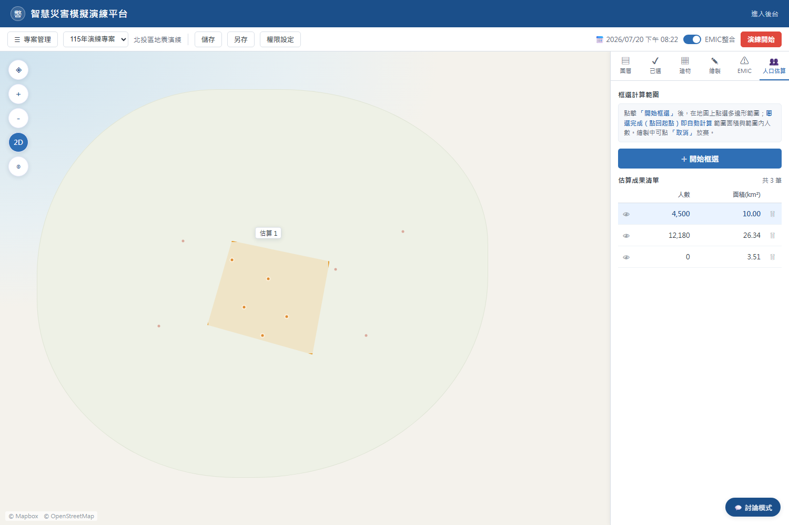

# 人口估算（框選工具）需求規格 v2
> 依據雛型：02_雛型/雛型_v2_人口估算.html（2026-08-24）｜上游：01_需求整理/01_需求摘要.md、確認紀錄/
> 狀態：草稿（待 PM 審閱）　｜　PM：evieliu@richitech.com.tw
> 案號：115GA7036 中央警察大學智慧災害模擬演練平台系統採購案

## 版本紀錄
| 版本 | 日期 | 依據雛型 | 主要異動 |
|------|------|----------|----------|
| v1 | 2026-08-04 | 雛型_v1_人口密度分析.html | 首次產出。依 req-intake 五輪收斂抽取。含 D-01 二次確認、演練完成不加橫幅、唯讀隱藏框選說明。 |
| v2 | 2026-08-24 | 雛型_v2_人口估算.html | 8/20 客戶訪談＋後續確認回填：①工具改名「人口估算」②**移除密度**，只留人數＋面積 ③網格 100m→**50m**（先試跑）④Q-01 精度定案（面積2位、人數整數）⑤新增**維護助手**角色（權限＝系統管理者）⑥圖層「建物人口概況」入合約範圍、本次不展開。 |
| v2 | 2026-08-24 | 雛型_v2（原地更新） | **D-02**（PG 開發提問→PM 決定）：框選改為**單一按鈕＋圈選完成自動計算**——面板僅一顆按鈕「開始框選↔取消」，圈選完成（點回起點/雙擊）自動計算、無「完成計算」鈕；繪製中點「取消」或 Esc 放棄（BR-09、AC-01/03/03b/c/d、畫面 1d）。 |

---

## 一、功能概述
災害演練平台右側面板「人口估算」頁籤下的框選工具。使用者在地圖上以任意多邊形框選範圍，系統自動加總範圍內人數並計算面積，作為救災調度與資源評估的判斷依據。每次估算成果新增一筆到清單、隨專案存檔。

- **US-01**（F-01）身為情境設定員／維護助手／系統管理者，我要在地圖上以任意多邊形框選範圍，系統自動加總範圍內人數與面積(km²)，以便快速掌握任一區域的人口概況。
- **US-02**（F-02）我要把每次框選結果新增一筆進成果清單（不另命名），點選清單項會與地圖對應範圍連動高亮，可刪除，以便並列比較多個區域。
- **US-03**（F-03）我要讓估算成果隨專案存檔、重開專案仍在。
- **US-04**（F-04）身為演練人員，我只能檢視已存成果、不能新框選。

> **【v2 移除】** 本工具只算人數＋面積，**不再計算密度**（8/20 客戶確認）。
> **範圍界定**：本規格僅含「人口估算」框選工具。圖層「建物人口概況」（分層設色）客戶已確認要做、屬合約內，本次不展開、另行處理（見附錄 C）。

---

## 二、畫面清單
| # | 畫面 | 雛型檔案 | 截圖 | 用途 |
|---|------|----------|------|------|
| 1 | 人口估算主畫面（框選工具） | 雛型_v2_人口估算.html | 畫面截圖/v2_人口估算_主畫面.png | 框選、估算、成果清單 |
| 1d | 繪製中狀態（單鈕變「取消」） | 同上 `?draw=1` | 畫面截圖/v2_人口估算_繪製中.png | 框選繪製進行中；按鈕為「取消」，圈選完成自動計算 |
| 1a | 空清單狀態 | 同上 `?sc=empty` | 畫面截圖/v2_人口估算_空清單.png | 尚無估算成果 |
| 1b | 演練完成唯讀狀態 | 同上 `?sc=done` | 畫面截圖/v2_人口估算_演練完成唯讀.png | 專案演練完成後僅可檢視 |
| 1c | 演練人員檢視狀態 | 同上 `?sc=viewer` | 畫面截圖/v2_人口估算_演練人員檢視.png | 演練人員僅檢視、無框選與刪除 |

---

## 三、畫面規格

### 3.1 人口估算主畫面（框選工具）

工具位於右側面板「人口估算」頁籤。由上而下：框選計算範圍說明 → 開始框選按鈕 → 估算成果清單。

**欄位／元素表**（來源：雛型 v2 SPEC 註解，唯一真實來源）
| 元素 | 欄位名 | 型別 | 必填 | 驗證規則 | 預設值 | 資料來源 | 互動行為 | F-編號 |
|------|--------|------|------|----------|--------|----------|----------|--------|
| 框選按鈕（開始框選 ↔ 取消） | — | 按鈕（單一、狀態切換） | — | 任意多邊形；至少 3 個頂點才能圈選完成 | 初始「開始框選」 | 使用者於地圖點選頂點 | 初始「開始框選」→點擊進入繪製、按鈕變「取消」；**於地圖圈選完成（點回起點/雙擊封閉多邊形）自動計算並新增一筆成果、按鈕回「開始框選」**（無獨立「完成計算」鈕）；繪製中點「取消」或按 Esc→放棄、清除已點頂點、回初始態、不存成果【PG提問→PM決定 D-02】 | F-01 |
| 人數 | population | 整數 | 是 | 範圍內 **50m 網格**中心點對應人口加總（原100m，先試跑）；**四捨五入至整數**【客戶確認 8/24】；無點位時為 0 | — | 系統計算 | 唯讀顯示；千分位逗號 | F-01 |
| 面積(km²) | area_km2 | 數值 | 是 | 框選多邊形面積；**小數點後 2 位**【客戶確認 8/24】 | — | 系統計算 | 唯讀顯示 | F-01 |
| 成果清單 列 | result_item | 清單項 | — | 每次完成計算新增一筆；不提供命名 | — | 估算結果 | 點整列→地圖對應框選範圍高亮；同一時間僅一列為選中態 | F-02 |
| 顯示／隱藏（👁） | visible | 切換 | — | 切換該筆框選範圍在地圖上的顯示 | 顯示 | — | 點擊切換；隱藏時該列數值淡化 | F-02 |
| 刪除（🗑） | — | 按鈕 | — | 移除該筆估算成果 | — | — | 點擊跳二次確認「確定刪除此筆估算成果？」，確認後才移除【PM決定 D-01】 | F-02 |

> **【v2 移除】** 密度(人/km²) 欄位已移除。

**業務規則**
- **BR-01**（F-01）〔v2〕人數加總邏輯：以本案人口密度分析產製之 **50m 網格**（原 100m，先試跑，效能不行再改回 100m）為單位，**網格中心點落入框選多邊形範圍即計入**該筆估算。（來源：memory/人口密度分析計算邏輯.md；網格由國土利用調查成果＋村里人口以面積加權攤分產製，兼商業使用住宅權重為其他 2 倍。）
- **BR-02**（F-01）框選範圍內無任何網格中心點（如山區、海域）→ 人數 0，仍正常完成計算並存為一筆（不視為錯誤）。
- **BR-03**（F-02）每次完成計算「新增一筆」到清單，不取代既有筆數；成果不命名，靠點選與地圖範圍連動辨識對應關係。
- **BR-04**（F-02）清單同一時間僅一列為選中（高亮）態；點另一列即切換，地圖上對應範圍改為高亮（紅框）。
- **BR-05**（F-03）估算成果隨專案存檔，重開專案仍在，與圖層套疊、地圖繪製共用同一套專案儲存機制。〔存檔資料結構屬技術層，交技術團隊；本規格只要求「重開仍在」。〕
- **BR-06**（F-04）〔v2〕角色權限：**情境設定員／維護助手／系統管理者**可框選估算、刪除成果（**維護助手權限＝系統管理者**）；**演練人員**僅檢視已存成果，不顯示「開始框選」與刪除鈕。
- **BR-07**（F-05）〔v2〕專案狀態＝「演練完成」或角色＝演練人員 → 僅可檢視，隱藏**整個「框選計算範圍」區塊（標題＋說明文字＋開始框選鈕）**與各列刪除鈕；**不顯示唯讀橫幅**、且**不出現「點擊開始框選…」操作說明文字**；已存成果仍可點選、可在地圖高亮檢視。
- **BR-08**（F-01）使用時機：演練前、演練中皆可框選估算。
- **BR-09**（F-01）〔v2 D-02，PG 提問→PM 決定〕框選採**單一按鈕＋圈選完成自動計算**：面板只有一顆按鈕，初始「開始框選」，點擊後進入繪製、按鈕變「取消」；使用者於地圖圈選完成（**點回起點或雙擊封閉多邊形**）即**自動計算**並新增一筆成果、按鈕回「開始框選」（**不設獨立「完成計算」鈕**）。繪製中點「取消」或按 **Esc** → 放棄本次框選、清除已點頂點、回初始態、不產生成果。

**例外流程與提示訊息**
| 情境 | 系統行為 | 訊息文字（實際文案，暫定待定稿） |
|------|----------|----------------------------------|
| 頂點少於 3 就想封閉多邊形 | 不完成、不自動計算，維持繪製中 | 「請至少標示 3 個點以圍成範圍」 |
| 繪製中按「取消」或 Esc | 放棄本次框選、清除已點頂點、回「開始框選」初始態 | （無提示，直接回初始態）【D-02】 |
| 框選範圍內無人口網格 | 正常完成、存一筆 | 人數欄顯示「0」（非錯誤，不跳提示） |
| 點刪除（🗑） | 先跳二次確認，取消則不刪 | 「確定刪除此筆估算成果？」【PM決定 D-01】 |
| 成果清單為空 | 顯示空狀態區塊 | 「尚無估算成果」／「點擊『開始框選』在地圖上標示範圍」 |
| 演練人員或演練完成專案進入 | 隱藏整個「框選計算範圍」區塊與各列刪除鈕；僅可檢視已存成果 | 無提示橫幅、不出現「點擊開始框選…」操作說明文字 |

---

## 四、權限與資料範圍
| 角色 | 可用操作 | 資料範圍 |
|------|----------|----------|
| 系統管理者 | 框選估算、顯示/隱藏、刪除（二次確認）；成果隨專案存檔 | 可操作之專案內成果 |
| 維護助手（權限＝系統管理者） | 同系統管理者：框選估算、顯示/隱藏、刪除；成果隨專案存檔 | 可操作之專案內成果 |
| 情境設定員 | 框選估算、顯示/隱藏、刪除；成果隨專案存檔 | 其為擁有者（可編輯）之專案內成果 |
| 演練人員 | 僅檢視已存成果、點選高亮；**不可**框選、不可刪除 | 可檢視之專案內成果 |
| （任一角色）於「演練完成」專案 | 僅檢視已存成果、點選高亮；**不可**框選、不可刪除 | 該專案已存成果 |

---

## 五、非功能需求
- 人數加總依既定計算邏輯（BR-01），計算所用 **50m 網格**資料由本案人口密度分析一次性產製（合約明列項目，見 memory/合約範圍與金額.md）。
- 使用時機：演練前、演練中皆可（BR-08）。
- **【待技術確認 Q-03】** 50m 網格資料量約為 100m 的 4 倍，計算時間／儲存／圖台渲染效能由技術主管試跑評估；策略已定：**先用 50m 試跑，效能不行再改回 100m**。

---

## 六、驗收條件（AC）— PG 自測與 PM 驗收共用
> PG 交付前逐項自測勾「PG自測」，全勾才交 PM；PM 驗收勾「PM驗收」。
> 不通過的在備註寫清楚現象：是 bug → PG 修復後複測；是需求認知差異或客戶改需求 → 回 /req-intake 從雛型改起。

| AC | 類別 | 對應 F | Given（前置） | When（操作） | Then（預期結果） | PG自測 | PM驗收 | 備註 |
|----|------|--------|---------------|--------------|------------------|--------|--------|------|
| AC-01 | 主流程 | F-01 | 以情境設定員登入、開啟一個演練前/演練中專案、切到「人口估算」頁籤 | 按「開始框選」，在地圖點 4 個頂點圍出一塊住宅區，**點回起點封閉多邊形** | **自動計算**、成果清單新增一筆，顯示人數（整數、千分位）與面積(km²，小數 2 位)；**無密度欄**；按鈕回「開始框選」 | ☐ | ☐ | 圈選完成即自動計算、無「完成計算」鈕 |
| AC-02 | 主流程 | F-01 | 承上，框選範圍內含 3 個 50m 網格中心點、人口各 1500 | 圈選完成 | 人數顯示「4,500」 | ☐ | ☐ | 驗證加總＝中心點落入即計入 |
| AC-03 | 例外 | F-01 | 已按「開始框選」進入繪製 | 只點 2 個頂點就想封閉多邊形 | 不完成、不自動計算、維持繪製中，顯示「請至少標示 3 個點以圍成範圍」 | ☐ | ☐ | |
| AC-03b | 主流程 | F-01 | 已按「開始框選」進入繪製（按鈕已變「取消」）、已點 2 個頂點 | 點「取消」鈕 | 放棄本次框選、清除已點頂點、按鈕回「開始框選」，清單筆數不變、不新增成果 | ☐ | ☐ | D-02 取消 |
| AC-03c | 主流程 | F-01 | 已按「開始框選」進入繪製、已點 4 個頂點 | 按鍵盤 **Esc** | 同 AC-03b：放棄本次框選、回初始態、不新增成果 | ☐ | ☐ | D-02 Esc |
| AC-03d | 主流程 | F-01 | 初始態（未開始框選） | 檢視面板 | 面板只有一顆「開始框選」按鈕；**無獨立「完成計算」鈕**；進入繪製後該按鈕才變為「取消」 | ☐ | ☐ | D-02 單鈕切換 |
| AC-04 | 例外 | F-01 | 以情境設定員登入 | 框選一塊完全落在海域、無任何網格中心點的範圍並完成計算 | 正常新增一筆，人數顯示「0」，不跳錯誤 | ☐ | ☐ | BR-02 |
| AC-05 | 主流程 | F-02 | 已有 1 筆估算成果 | 再框選另一區域並完成計算 | 清單變為 2 筆（新增而非取代），筆數「共 2 筆」 | ☐ | ☐ | BR-03 |
| AC-06 | 主流程 | F-02 | 清單有 2 筆以上成果 | 點選清單中第 2 筆（整列） | 該列高亮為選中態、第 1 筆取消選中；地圖上對應框選範圍高亮（紅框） | ☐ | ☐ | BR-04 同時僅一列選中 |
| AC-07 | 主流程 | F-02 | 清單有 1 筆成果、其地圖範圍顯示中 | 點該列的眼睛（👁）圖示 | 地圖上該範圍隱藏、該列數值淡化；再點一次恢復顯示 | ☐ | ☐ | |
| AC-08 | 主流程 | F-02 | 清單有 2 筆成果 | 點第 1 筆刪除（🗑）→ 彈出「確定刪除此筆估算成果？」→ 按確定 | 該筆從清單移除、地圖對應範圍移除，筆數更新為「共 1 筆」 | ☐ | ☐ | D-01 二次確認 |
| AC-08b | 例外 | F-02 | 清單有 2 筆成果 | 點刪除（🗑）→ 二次確認彈窗按「取消」 | 不刪除，清單維持 2 筆 | ☐ | ☐ | D-01 取消路徑 |
| AC-09 | 例外 | F-02 | 專案內無任何估算成果 | 開啟「人口估算」頁籤 | 顯示空狀態「尚無估算成果／點擊『開始框選』在地圖上標示範圍」，不顯示清單表格 | ☐ | ☐ | |
| AC-10 | 主流程 | F-03 | 情境設定員已存 2 筆估算成果並儲存專案 | 關閉專案後重新開啟同一專案 | 2 筆估算成果仍在清單、可點選在地圖高亮 | ☐ | ☐ | BR-05 |
| AC-11 | 權限 | F-04 | 以演練人員登入、開啟一個含已存成果的專案 | 進入「人口估算」頁籤 | 可見成果清單並可點選高亮；**不顯示**整個「框選計算範圍」區塊（含「點擊開始框選…」說明文字與按鈕）與各列刪除鈕 | ☐ | ☐ | BR-06 |
| AC-12 | 權限 | F-05 | 以情境設定員登入、開啟一個「演練完成」的專案 | 進入「人口估算」頁籤 | 隱藏整個「框選計算範圍」區塊與各列刪除鈕；畫面上**看不到**「點擊開始框選…」文字；已存成果仍可點選高亮；不顯示任何唯讀橫幅 | ☐ | ☐ | BR-07 |
| AC-13 | 權限 | F-04 | 以系統管理者登入、演練中專案 | 框選估算 | 可框選、估算、存檔（與情境設定員一致） | ☐ | ☐ | 系統管理者=情境設定員操作 |
| AC-14 | 權限 | F-04 | 以**維護助手**登入、演練中專案 | 進入「人口估算」頁籤並框選估算、刪除 | 可框選、估算、刪除（二次確認），行為與系統管理者完全一致 | ☐ | ☐ | 維護助手權限＝系統管理者 |

**驗收彙總**：總測項 18｜通過 __｜不通過 __

---

## 七、追溯表
| F-編號 | 需求 | 畫面 | 規格章節 | AC |
|--------|------|------|----------|-----|
| F-01 | 框選估算（人數＋面積，無密度；含繪製取消） | 3.1 | §三 欄位表、BR-01/02/08/09、例外表 | AC-01, AC-02, AC-03, AC-03b, AC-03c, AC-03d, AC-04, AC-13, AC-14 |
| F-02 | 成果清單（新增/高亮/顯示隱藏/刪除二次確認） | 3.1 | §三 欄位表、BR-03/04 | AC-05, AC-06, AC-07, AC-08, AC-08b, AC-09 |
| F-03 | 成果隨專案存檔 | 3.1 | §三 BR-05 | AC-10 |
| F-04 | 角色權限（含維護助手、演練人員僅檢視） | 3.1(1c) | §四、BR-06 | AC-11, AC-13, AC-14 |
| F-05 | 演練完成鎖定 | 3.1(1b) | §四、BR-07 | AC-12 |

---

## 附錄

### A. 一致性檢查結果（2026-08-24）
- ✅ 需求摘要 F-01~F-05 全數在雛型 v2 有對應 SPEC 與畫面元素，並在規格 §三/§四 展開。
- ✅ 雛型 v2 所有畫面元素（開始框選、人數/面積、清單列、眼睛、刪除、空狀態）皆有欄位表列與 AC，無「有畫面無規格」項；密度欄位已於雛型與規格一致移除。
- ✅ 每個 F-編號皆有 ≥1 條 AC 覆蓋（見追溯表），無漏驗需求。
- ✅ Q-01 顯示精度已客戶確認（8/24），雛型與規格一致（面積 2 位、人數整數）。
- ✅ 維護助手角色已補入 BR-06、§四權限表、AC-14（權限＝系統管理者）。
- ✅ **D-02 框選互動**（PG 開發提問→PM 決定）：單一按鈕＋圈選完成自動計算、繪製中變「取消」，雛型與規格一致（BR-09、欄位表、例外表、AC-01/03/03b/c/d、畫面 1d）。
- ⚠️ **Q-03 50m 網格效能**：待技術主管試跑；策略已定（不行改回 100m）。屬非功能待確認，不影響功能規格。

### B. 待定清單
| 編號 | 項目 | 狀態 | 誰決定 | 說明 |
|------|------|------|--------|------|
| Q-03 | 50m 網格效能（資料量約 100m 的 4 倍） | 【待技術確認】 | 技術主管＋PM | 先用 50m 試跑，效能不行再改回 100m |
| — | 例外/空狀態訊息文案 | 暫定 | PM | 文案定稿前以雛型現行文字為準 |

### C. 範圍外（另行處理）
- **圖層「建物人口概況」**（8/20 客戶確認要做、屬合約內，本次不展開）：納入圖層清單的系統圖層，呈現「村里內各住宅用地人口」，需分層設色。級距與色碼（客戶提供，黃→紅）：0~200 `#FFFF00`／200~500 `#F5B800`／500~1000 `#F57A00`／1000~5000 `#F50000`／5000以上 `#980A0A`。計算流程與級距色碼詳見 memory/人口密度分析計算邏輯.md 與 01_需求整理/確認紀錄/確認_20260820_客戶訪談.md。日後另立處理時再產規格。
