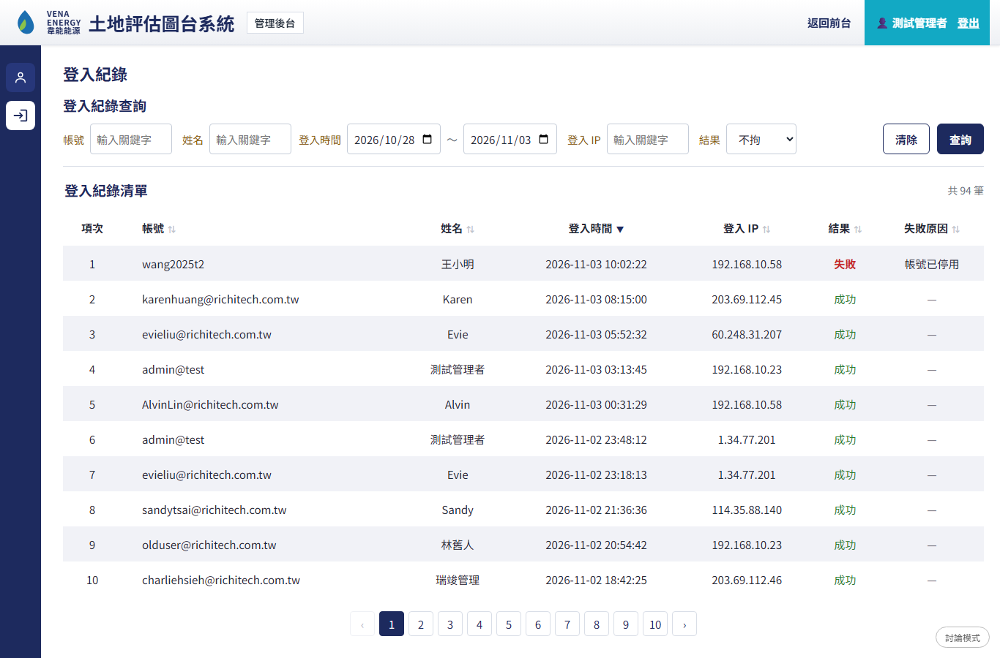
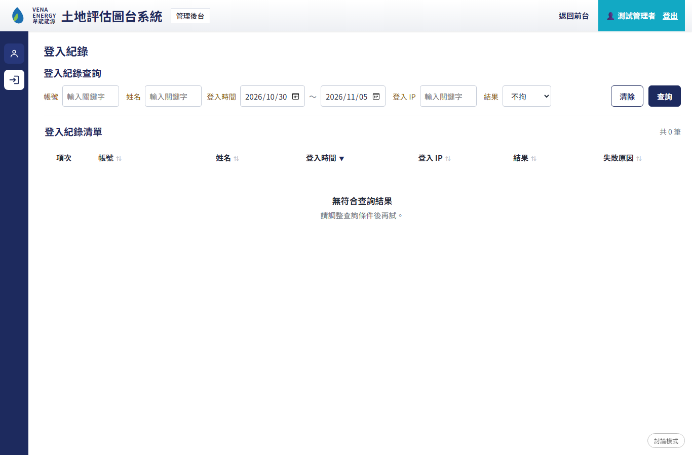

# 登入紀錄 需求規格 v1
> 依據雛型：[02_雛型/雛型_v1_後台_登入紀錄.html](../02_雛型/雛型_v1_後台_登入紀錄.html)（2026-10-29）｜上游：[01_需求整理/](../01_需求整理/01_需求摘要.md)
> 狀態：草稿｜PM：evieliu@richitech.com.tw｜對應合約：增補協議項次 3.1（NT$110,000）

## 版本紀錄
| 版本 | 日期 | 依據雛型 | 主要異動 |
|------|------|----------|----------|
| v1 | 2026-10-22 | v1 | 首次產出。F-04（失敗登入與結果欄）為暫定，待合約與技術確認 |
| v1 | 2026-10-22 | v1（原地調整，尚未對外） | PM 決定介面不標示帳號是否被刪除，移除「（帳號已刪除）」後綴 |
| v1 | 2026-10-29 | v1（原地調整，尚未對外） | 【更新 2026-10-29】依技術討論：①不另做權限判斷與無權限畫面 ②失敗原因只有「帳號已停用」「帳號不存在」 ③失敗原因欄可排序 ④不處理保存期限 ⑤登入時間預設近 1 週且不限制可查區間 ⑥「使用者姓名」統一為「姓名」 ⑦帳號欄內容靠左 |
| v1 | 2026-10-30 | v1（原地調整，尚未對外） | 【更新 2026-10-30】左側「登入紀錄」按鈕改用 Material Icons Outlined「login」圖示，並確認懸停提示。查詢條件依視窗寬度自動換行，換行處在「登入時間」之前。PM 確認：①「清除」回到近 1 週 ②失敗登入（F-04）直接做，不追加報價，不再是暫定 ③每頁 10 筆，與既有後台一致 |
| v1 | 2026-11-17 | v1（原地調整，尚未對外） | 【更新 2026-11-17】依技術實作回填：①登入時間日曆互相鎖定（迄日不可選早於起日、起日不可選晚於迄日，起日可等於迄日）②日期欄可用鍵盤輸入，紅字驗證保留 ③沒有清除按鈕，日期欄刪成空白或不合法時自動變成當天，不可全查，移除「只填一端」「不限期間」（影響 BR-06、新增 BR-11、AC-23、24、30、31，新增 AC-45～47） |

## 一、功能概述
在土地評估圖台系統「管理後台」新增「登入紀錄」頁，讓系統管理者查看每次登入嘗試的帳號、姓名、時間與來源 IP，並可用條件篩選，作為資安稽核與追查異常登入使用。紀錄唯讀，不可編輯、不可刪除。

- User Story：身為系統管理者，我要在後台查看誰在何時從哪個 IP 登入，並用帳號、姓名、登入時間、IP 篩選，以便資安稽核與追查異常登入。
- User Story（F-04）：身為系統管理者，我要區分登入成功與失敗並看到失敗原因，以便發現異常的登入嘗試。技術已確認可做。
- 只記登入，不記登出。帳號被刪除後，該帳號過去的登入紀錄仍保留。

## 二、畫面清單
| # | 畫面 | 雛型檔案 | 截圖 | 用途 |
|---|------|----------|------|------|
| 1 | 後台・登入紀錄（有資料） | 雛型_v1_後台_登入紀錄.html | 畫面截圖/v1_後台_登入紀錄_清單.png | 查詢條件＋清單＋分頁 |
| 2 | 後台・登入紀錄（無符合查詢結果） | 同上（`?state=empty`） | 畫面截圖/v1_後台_登入紀錄_尚無紀錄.png | 非理想狀態 |

## 三、畫面規格

### 3.1 左側選單入口（F-01）
- 後台左側圖示列，在「帳號管理」下方新增「登入紀錄」按鈕，圖示使用 Material Icons Outlined 的「login」（24px），滑鼠移上（或鍵盤聚焦）時在按鈕右側立即顯示深色提示框，文字為按鈕名稱「登入紀錄」（「帳號管理」按鈕同樣顯示）；目前所在頁的按鈕為白底，其餘為深藍底。
- 後台目前只有系統管理者能進入，沿用既有機制，本功能不另做權限判斷。

### 3.2 登入紀錄頁（F-02、F-03、F-04）

頁面由上而下：頁面標題「登入紀錄」→「登入紀錄查詢」區（查詢條件依視窗寬度自動換行：寬度足夠時排成一行；不夠時從「登入時間」之前換行，帳號、姓名在前一組，登入時間、登入 IP、結果與靠右的「清除」「查詢」按鈕在後一組）→ 分隔線 →「登入紀錄清單」區（右上角「共 N 筆」）→ 分頁。

**欄位表（查詢條件）**
| 元素 | 欄位名 | 型別 | 必填 | 驗證規則 | 預設值 | 互動行為 | F-編號 |
|------|--------|------|------|----------|--------|----------|--------|
| 文字框 | 帳號 | 文字 | 否 | 長度上限【需 PG 確認】 | 空，提示「輸入關鍵字」 | 包含比對，不分大小寫 | F-03 |
| 文字框 | 姓名 | 文字 | 否 | 同上 | 空，提示「輸入關鍵字」 | 包含比對，不分大小寫 | F-03 |
| 日期選擇 | 登入時間（起） | 日期 yyyy-MM-dd | 是（刪成空白或格式不合法時自動變成當天） | 起日不可晚於迄日 | 今天往前 6 天（含今天共 7 天） | 比對 起日 00:00:00 起；日曆中晚於迄日的日期不可點選（起日可等於迄日）；可用鍵盤直接輸入；不限制可查詢的區間範圍【技術確認 2026-11-17】 | F-03 |
| 日期選擇 | 登入時間（迄） | 日期 yyyy-MM-dd | 是（刪成空白或格式不合法時自動變成當天） | 同上 | 今天 | 比對 迄日 23:59:59 止；日曆中早於起日的日期不可點選（迄日可等於起日）；可用鍵盤直接輸入；沒有清除按鈕，不可全查【技術確認 2026-11-17】 | F-03 |
| 文字框 | 登入 IP | 文字 | 否 | 長度上限【需 PG 確認】 | 空，提示「輸入關鍵字」 | 包含比對（輸入 192.168 可查整個網段） | F-03 |
| 下拉 | 結果 | 選單 | 否 | — | 不拘 | 不拘、成功、失敗，精確比對 | F-04 |
| 按鈕 | 查詢 | — | — | — | — | 套用條件、回第 1 頁、保留目前排序 | F-03 |
| 按鈕 | 清除 | — | — | — | — | 回到預設條件（登入時間近 1 週，其餘條件清空）並重新查詢，回第 1 頁【PM 確認 2026-10-30】 | F-03 |

**欄位表（清單）**
| 元素 | 欄位名 | 型別 | 資料來源 | 互動行為 | F-編號 |
|------|--------|------|----------|----------|--------|
| 欄 | 項次 | 整數 | 依排序與頁碼連續編號，第 2 頁從 11 起 | 不可排序 | F-02 |
| 欄 | 帳號 | 文字 | 登入當下輸入的帳號（寫入時存快照） | 可排序；欄位標題與內容靠左對齊；介面不標示帳號目前是否仍存在 | F-02 |
| 欄 | 姓名 | 文字 | 登入當下該帳號的姓名（快照）；帳號不存在時顯示「—」 | 可排序 | F-02 |
| 欄 | 登入時間 | yyyy-MM-dd HH:mm:ss | 系統時間 | 可排序，預設由新到舊 | F-02 |
| 欄 | 登入 IP | IPv4 文字 | 登入請求的來源 IP（經代理或負載平衡時如何取得，需 PG 確認） | 可排序 | F-02 |
| 欄 | 結果 | 成功／失敗 | 登入驗證結果 | 可排序；成功綠字，失敗紅字粗體 | F-04 |
| 欄 | 失敗原因 | 文字 | 帳號已停用、帳號不存在；成功者顯示「—」 | 可排序；成功者視為空值 | F-04 |
| 分頁 | 頁碼 | — | 第 1 頁、每頁 10 筆（與既有後台一致【PM 確認 2026-10-30】） | 上一頁、頁碼、下一頁；第 1 頁時上一頁停用，最後一頁時下一頁停用 | F-02 |

**業務規則**
- BR-01（F-01）：登入紀錄為後台功能，沿用後台既有進入機制（目前只有系統管理者能進後台）；本功能不另做權限判斷，也沒有無權限畫面。
- BR-02（F-02）：每次登入嘗試寫入一筆紀錄，寫入當下保存帳號與姓名。之後帳號被刪除、改名或停用，都不影響既有紀錄，已刪除帳號的紀錄仍可查到。
- BR-03（F-02）：紀錄唯讀，畫面沒有新增、修改、刪除；不特別處理保存期限，不自動清除。只記登入，不記登出。
- BR-04（F-02）：預設依登入時間由新到舊。點可排序欄位標題切換排序：「登入時間」第一次點為由新到舊，其餘欄位為升冪，再點反向；切換後回第 1 頁；排序套用在整份查詢結果。「失敗原因」成功者視為空值，升冪排最前、降冪排最後。
- BR-05（F-03）：多個條件同時成立才列出（AND），空條件表示不限。
- BR-06（F-03）：登入時間區間含起日與迄日當天，起迄兩欄都必須有值（沒有「只填一端」或「不限期間」）。不限制可查詢的區間範圍，使用者仍可查 1 年或更長。
- BR-07（F-02）：「共 N 筆」是符合條件的總筆數，不隨頁碼變動。
- BR-08（F-04）：成功與失敗登入都寫入。失敗情境只有兩種：帳號已停用（帳號與姓名照常記錄）、帳號不存在（帳號欄存輸入值，姓名欄顯示「—」）。技術已確認可做；PM 確認直接做，不追加報價【PM 確認 2026-10-30】。
- BR-09（F-03）：進入頁面時，登入時間預設為近 1 週並以此條件查詢（迄日＝今天、起日＝今天往前 6 天，含今天共 7 天）。
- BR-10（F-02）：帳號欄（標題與內容）靠左對齊，其餘欄位維持置中。
- BR-11（F-03）：登入時間的兩個日期欄互相限制。迄日的日曆中，早於起日的日期為灰色、不可點選；起日的日曆中，晚於迄日的日期為灰色、不可點選；起日可等於迄日（單日查詢）。日期欄也可用鍵盤直接輸入，鍵盤輸入可繞過日曆限制，所以按「查詢」時仍要檢查「起日不可晚於迄日」並顯示紅字。日期欄沒有清除按鈕；若被鍵盤刪成空白或輸入不合法的日期，該欄自動變成當天，因此不會變成全期間查詢【技術確認 2026-11-17；自動變成當天的觸發時機需 PG 確認】。

### 3.3 非理想狀態

**例外流程與錯誤訊息**
| 情境 | 系統行為 | 訊息文字（實際文案） |
|------|----------|----------------------|
| 查詢條件下無符合資料 | 表格區顯示提示，「共 0 筆」，不顯示分頁 | 「無符合查詢結果」＋「請調整查詢條件後再試。」 |
| 系統尚無任何紀錄 | 同上 | 「無符合查詢結果」＋「請調整查詢條件後再試。」 |
| 起日晚於迄日按「查詢」（日曆選不到，只會在鍵盤直接輸入時發生） | 不送出查詢，清單維持原樣，條件列下方顯示紅字 | 「登入時間的起日不可晚於迄日」 |
| 日期欄被刪成空白或輸入不合法的日期 | 該欄自動變成當天，不顯示錯誤，也不會變成全期間查詢 | 無訊息 |

> 以上文案為雛型暫定文案【待 PM 審閱】，既有後台未提供可沿用的對應訊息。

## 四、權限與資料範圍
登入紀錄屬後台功能，沿用既有機制：目前只有系統管理者能進入後台，因此只有系統管理者能使用；本功能不另做權限判斷。

| 角色 | 可用操作 | 資料範圍 |
|------|----------|----------|
| 系統管理者 | 查詢、排序、分頁 | 全部帳號的登入紀錄（含已刪除帳號） |

## 五、非功能需求
- 紀錄持續累積，清單必須分頁；查詢與排序在大量資料下的效能指標【待定，需技術主管確認】。
- 登入時間以伺服器時間記錄，顯示格式 yyyy-MM-dd HH:mm:ss（西元年，沿用雛型【待 PM 確認】）。
- IP 屬敏感資訊，僅在後台顯示。

## 六、驗收條件（AC）— PG 自測與 PM 驗收共用
> PG 交付前逐項自測勾「PG自測」，全勾才交 PM；PM 驗收勾「PM驗收」。
> 不通過的在備註寫清楚現象：是 bug → PG 修復後複測；是需求認知差異或客戶改需求 → 回 /req-intake 從雛型改起。
> F-04（失敗登入與結果欄）已確認直接做，AC-37～43 照常驗收。

| AC | 類別 | 對應 F | Given（前置） | When（操作） | Then（預期結果） | PG自測 | PM驗收 | 備註 |
|----|------|--------|---------------|--------------|------------------|--------|--------|------|
| AC-01 | 主流程 | F-01 | 以系統管理者登入後台 | 查看左側圖示列，並把滑鼠移到「登入紀錄」按鈕上 | 「帳號管理」下方有「登入紀錄」按鈕；滑鼠移上時按鈕右側立即出現深色提示框，文字為「登入紀錄」；移開後提示消失 | ☐ | ☐ | |
| AC-02 | 主流程 | F-01 | 同 AC-01 | 點「登入紀錄」按鈕 | 進入登入紀錄頁，標題「登入紀錄」，該按鈕為白底 | ☐ | ☐ | |
| AC-03 | 主流程 | F-02 | 近 1 週內有 25 筆紀錄，進入登入紀錄頁 | 查看清單 | 欄位依序為項次、帳號、姓名、登入時間、登入 IP、結果、失敗原因；右上顯示「共 25 筆」 | ☐ | ☐ | |
| AC-04 | 主流程 | F-03 | 今天為 2026-10-29 | 進入登入紀錄頁 | 登入時間預設起日 2026-10-23、迄日 2026-10-29，清單只含該區間（含兩端當天）的紀錄 | ☐ | ☐ | |
| AC-05 | 主流程 | F-03 | 有一筆登入時間為 2026-10-22 23:59:59 的紀錄 | 進入登入紀錄頁（預設區間） | 該筆不在清單中 | ☐ | ☐ | |
| AC-06 | 主流程 | F-02 | 同 AC-03 | 查看第 1 頁 | 顯示 10 筆，登入時間最新的在最上方，項次 1～10 | ☐ | ☐ | |
| AC-07 | 主流程 | F-02 | 同 AC-03 | 點頁碼「2」 | 顯示項次 11～20，頁碼 2 為深藍底 | ☐ | ☐ | |
| AC-08 | 主流程 | F-02 | 同 AC-03 | 點頁碼「3」 | 顯示 5 筆（項次 21～25），「下一頁」停用 | ☐ | ☐ | |
| AC-09 | 主流程 | F-02 | 目前在第 1 頁 | 查看「上一頁」 | 按鈕停用，不可點擊 | ☐ | ☐ | |
| AC-10 | 主流程 | F-02 | 帳號 test@x 於 2026-10-29 09:42:17 從 192.168.10.58 登入成功 | 查看該筆 | 登入時間「2026-10-29 09:42:17」，IP「192.168.10.58」，帳號與姓名與登入當下一致 | ☐ | ☐ | |
| AC-11 | 主流程 | F-02 | 帳號 olduser 曾登入，之後被管理者從帳號管理刪除 | 查看該帳號的紀錄 | 紀錄仍在，帳號欄顯示「olduser」、姓名為當時姓名，後面沒有任何「已刪除」之類標示 | ☐ | ☐ | |
| AC-12 | 主流程 | F-02 | 帳號 Evie 登入後姓名改為「Evie L」 | 查看登入前的舊紀錄 | 舊紀錄姓名仍為「Evie」，新紀錄為「Evie L」 | ☐ | ☐ | |
| AC-13 | 主流程 | F-02 | 任一使用者成功登入前台 | 管理者重新查詢 | 新增一筆該帳號的紀錄，登入時間與實際相差不超過 1 分鐘 | ☐ | ☐ | |
| AC-14 | 主流程 | F-02 | 進入登入紀錄頁 | 查看清單與頁面 | 沒有新增、修改、刪除的按鈕或連結 | ☐ | ☐ | |
| AC-15 | 主流程 | F-02 | 預設排序（登入時間 ▼） | 點「登入時間」標題 | 改為由舊到新，箭頭變 ▲，回第 1 頁 | ☐ | ☐ | |
| AC-16 | 主流程 | F-02 | 預設排序 | 點「帳號」標題 | 依帳號升冪（A→Z），再點一次改降冪；回第 1 頁 | ☐ | ☐ | |
| AC-17 | 主流程 | F-02 | 目前在第 2 頁 | 點「姓名」標題 | 跨所有頁依姓名排序，並回第 1 頁 | ☐ | ☐ | |
| AC-18 | 主流程 | F-02 | 進入登入紀錄頁 | 查看「帳號」欄 | 欄位標題與每列帳號文字靠左對齊，其餘欄位置中 | ☐ | ☐ | |
| AC-19 | 主流程 | F-03 | 清單有 AlvinLin@richitech.com.tw | 帳號輸入「alvin」按「查詢」 | 只列帳號含 alvin（不分大小寫）的紀錄 | ☐ | ☐ | |
| AC-20 | 主流程 | F-03 | 清單有姓名「王小明」的紀錄 | 姓名輸入「小明」按「查詢」 | 只列姓名含「小明」的紀錄 | ☐ | ☐ | |
| AC-21 | 主流程 | F-03 | 清單有 192.168.10.23、192.168.10.58 及其他網段 | 登入 IP 輸入「192.168」按「查詢」 | 只列 IP 含 192.168 的紀錄 | ☐ | ☐ | |
| AC-22 | 主流程 | F-03 | 有 10-15 與 10-16 的紀錄 | 登入時間選 2026-10-16～2026-10-16 查詢 | 只列 10-16 當天 00:00:00～23:59:59 的紀錄 | ☐ | ☐ | |
| AC-23 | 主流程 | F-03 | 同 AC-22 | 把迄日欄位文字刪除，只留起日 2026-10-16 | 迄日自動變成今天，按「查詢」以 2026-10-16～今天查詢，不會出現空白日期 | ☐ | ☐ | 技術確認 2026-11-17 |
| AC-24 | 主流程 | F-03 | 迄日為今天 | 把起日欄位文字刪除 | 起日自動變成今天；按「查詢」只列今天（單日）的紀錄 | ☐ | ☐ | 技術確認 2026-11-17 |
| AC-25 | 主流程 | F-03 | 清單有帳號 Evie 於 10-16 的紀錄 | 帳號輸入「evie」並選日期 10-16～10-16 查詢 | 只列同時符合兩條件的紀錄（AND） | ☐ | ☐ | |
| AC-26 | 主流程 | F-03 | 已查詢並在第 3 頁 | 按「查詢」 | 回第 1 頁 | ☐ | ☐ | |
| AC-27 | 主流程 | F-03 | 已改過多個條件並查詢 | 按「清除」 | 其他條件清空、結果回「不拘」，登入時間回到近 1 週，並重新查詢、回第 1 頁 | ☐ | ☐ | PM 確認 2026-10-30 |
| AC-28 | 主流程 | F-03 | 已依登入時間由舊到新排序 | 輸入帳號條件查詢 | 結果仍保持由舊到新排序 | ☐ | ☐ | |
| AC-29 | 主流程 | F-03 | 系統有一年內的紀錄 | 登入時間選起日 2025-10-29、迄日 2026-10-29 查詢 | 照常查詢並列出該範圍內的紀錄，不提示區間過長，也不拒絕 | ☐ | ☐ | 不限制區間 |
| AC-30 | 主流程 | F-03 | 進入登入紀錄頁 | 把起日與迄日都刪除後按「查詢」 | 兩欄都自動變成今天，只列今天的紀錄；不會列出全部期間 | ☐ | ☐ | 沒有清除按鈕，不可全查 |
| AC-31 | 驗證 | F-03 | 進入登入紀錄頁 | 用鍵盤直接輸入起日 2026-10-17、迄日 2026-10-16 後按「查詢」 | 清單不變，條件列下方紅字「登入時間的起日不可晚於迄日」 | ☐ | ☐ | |
| AC-32 | 驗證 | F-03 | AC-31 的錯誤訊息顯示中 | 迄日改為 2026-10-17 再查詢 | 錯誤訊息消失，正常查詢 | ☐ | ☐ | |
| AC-33 | 驗證 | F-03 | 進入登入紀錄頁 | 帳號輸入「%」或「'」查詢 | 視為一般文字比對，不報錯、不外洩全部資料 | ☐ | ☐ | |
| AC-34 | 驗證 | F-03 | 進入登入紀錄頁 | 帳號輸入前後有空白的「 alvin 」查詢 | 前後空白不影響結果，等同「alvin」 | ☐ | ☐ | |
| AC-35 | 例外 | F-03 | 清單有資料 | 帳號輸入「zzzzzz」查詢 | 顯示「無符合查詢結果」與「請調整查詢條件後再試。」，「共 0 筆」，無分頁 | ☐ | ☐ | |
| AC-36 | 例外 | F-02 | 系統尚無任何紀錄 | 進入登入紀錄頁 | 顯示「無符合查詢結果」與「請調整查詢條件後再試。」，「共 0 筆」 | ☐ | ☐ | |
| AC-37 | 主流程 | F-04 | 已停用帳號 wang2025t2 嘗試登入 | 查看該筆 | 帳號 wang2025t2、姓名為該帳號姓名，結果為紅字「失敗」，失敗原因「帳號已停用」 | ☐ | ☐ | |
| AC-38 | 主流程 | F-04 | 以不存在的帳號 nobody@x 嘗試登入 | 查看該筆 | 帳號「nobody@x」，姓名「—」，結果「失敗」，失敗原因「帳號不存在」 | ☐ | ☐ | |
| AC-39 | 主流程 | F-04 | 成功登入的紀錄 | 查看該筆 | 結果為綠字「成功」，失敗原因為「—」 | ☐ | ☐ | |
| AC-40 | 主流程 | F-04 | 清單同時有成功與失敗 | 結果選「失敗」查詢 | 只列失敗紀錄 | ☐ | ☐ | |
| AC-41 | 主流程 | F-04 | 同 AC-40 | 結果選「成功」查詢 | 只列成功紀錄 | ☐ | ☐ | |
| AC-42 | 主流程 | F-04 | 同 AC-40 | 結果選「不拘」查詢 | 成功與失敗都列出 | ☐ | ☐ | |
| AC-43 | 主流程 | F-04 | 清單有帳號已停用、帳號不存在與成功紀錄 | 點「失敗原因」標題 | 依失敗原因升冪排序（成功者無原因，排最前），再點一次反向（成功者排最後）；回第 1 頁 | ☐ | ☐ | |
| AC-44 | 非功能 | F-02 | 系統有 10,000 筆紀錄 | 進入頁面並翻頁、查詢 | 回應時間要求待技術主管確認後補上 | ☐ | ☐ | 【待定 Q-04：效能指標】 |
| AC-45 | 驗證 | F-03 | 起日為 2026-10-20 | 開啟迄日的日曆 | 2026-10-19（含）以前的日期為灰色、不可點選；2026-10-20 可以選（單日查詢） | ☐ | ☐ | 技術確認 2026-11-17 |
| AC-46 | 驗證 | F-03 | 迄日為 2026-10-30 | 開啟起日的日曆 | 2026-10-31（含）以後的日期為灰色、不可點選；2026-10-30 可以選 | ☐ | ☐ | 技術確認 2026-11-17 |
| AC-47 | 驗證 | F-03 | 進入登入紀錄頁 | 在起日欄用鍵盤輸入不合法的日期（例如 2026-13-45 或文字），離開欄位或按「查詢」 | 該欄自動變成今天，不顯示錯誤，也不會變成全期間查詢 | ☐ | ☐ | 觸發時機需 PG 確認 |

**驗收彙總**：總測項 47（含 F-04 7 項）｜通過 __｜不通過 __

## 七、追溯表
| F-編號 | 畫面 | 規格章節 | AC |
|--------|------|----------|-----|
| F-01 | 左側選單 | 3.1、BR-01、四 | AC-01、02 |
| F-02 | 登入紀錄頁（清單、分頁、排序）、尚無紀錄 | 3.2、3.3、BR-02～04、07、10 | AC-03、06～18、36、44 |
| F-03 | 登入紀錄頁（查詢條件） | 3.2、BR-05、06、09、11 | AC-04、05、19～35、45～47 |
| F-04 | 登入紀錄頁（結果、失敗原因） | 3.2、BR-08 | AC-37～43 |

## 附錄
### A. 一致性檢查結果（2026-10-29）
| # | 項目 | 結果 | 建議 |
|---|------|------|------|
| 1 | 需求摘要 F-01～F-04 是否都在雛型出現 | ✅ 全部有 | — |
| 2 | 雛型有、需求摘要沒有的元素 | ⚠️ 項次欄、分頁元件、排序箭頭與各提示文案是 AI 依 PM 決定補出的 | 請 PM 確認接受（文案見 3.3） |
| 3 | 每頁筆數 | ✅ 雛型 10 筆，與既有後台一致 | 已由 PM 確認（2026-10-30） |
| 4 | 日期時間格式 | ⚠️ 既有後台沒有日期欄可對照，雛型用西元 yyyy-MM-dd HH:mm:ss | 請 PM 確認是否要民國年 |
| 5 | 「近 1 週」與「清除」 | ✅ 雛型為今天往前 6 天共 7 天，按「清除」回到近 1 週 | 已由 PM 確認（2026-10-30） |
| 6 | 每個 F 是否有 AC | ✅ F-01～F-04 皆有；AC-44 因效能指標待定而留白 | — |
| 7 | 欄位與畫面是否一致 | ✅ 名詞已統一為「帳號」「姓名」 | — |

### B. 待定清單
| 編號 | 項目 | 標記 | 決策者 |
|------|------|------|--------|
| Q-04 | 查詢效能指標（資料量大時的回應時間要求） | 【待定】 | 技術主管 |
| — | 帳號、姓名、IP 輸入長度上限 | 【需 PG 確認】 | PG |
| — | 經代理或負載平衡時如何取得來源 IP | 【需 PG 確認】 | PG |

已結案（2026-10-29 技術討論）：Q-02 失敗登入可取得（失敗原因只有兩種）；Q-03 不特別處理保存期限；Q-05 「清除」回到近 1 週（PM 2026-10-30）；Q-01 失敗登入直接做、不追加報價（PM 2026-10-30，見 [變更紀錄](../06_變更紀錄/變更_2026-10-16_失敗登入紀錄.md)）；每頁 10 筆（PM 2026-10-30）；登入時間區間不設上限（但日期不可為空、不可全查）；日曆互相鎖定、空白自動變當天（技術 2026-11-17）；權限沿用後台既有機制（只有系統管理者能進後台）。
