# 競合分析 需求規格 v4
> 依據雛型：02_雛型/雛型_v4_競合分析管理.html（2026-11-13）｜上游：01_需求整理/（需求摘要、確認紀錄）｜對應合約項次 2.4
> 狀態：草稿（待 PM 審閱）｜客戶：台灣韋能能源「土地評估圖台系統」

## 版本紀錄
| 版本 | 日期 | 依據雛型 | 主要異動 |
|------|------|----------|----------|
| v4 | 2026-11-13 | v4 | 首次產出規格。v1～v3 為討論用雛型（v1：2026-10-13 訪談；v3：2026-11-12 客戶訪談），規格以 v4 定稿內容為準。 |

## 一、功能概述
韋能目前以 Excel 手工維護光電市場競合表（約 520 筆、多人編輯、坐標格式混雜、缺漏多、無編輯歷程）。本功能在土地評估圖台上提供：

- 圖層套疊新增「光電能源案場」分類，展繪競合案場；
- 「競合分析管理」面板，讓韋能同仁新增、編輯、刪除案場，並可共編（單一案場鎖定）；
- 編輯軌跡（欄位前後值）與依篩選條件匯出 Excel。

**User Story**
- US-01：身為韋能同仁，我要在圖層套疊看到面（施工/已併網）與點（開發/許可中）的競合案場，以便評估土地競合。
- US-02：身為韋能同仁，我要在清單中新增、編輯、刪除案場，以便維持競合資料最新。
- US-03：身為共編者，我要在別人編輯某案場時看到它被鎖定，以便避免覆蓋彼此的修改。
- US-04：身為韋能同仁，我要查看全部或單一案場的編輯軌跡，以便追溯誰改了什麼。

**不在本次範圍**：能源署面資料（面圖層）不可共編；審核確認功能已取消；Excel 匯入功能（資料由客戶依我方提供的清單整理好，匯入方式見附錄 B）。

## 二、畫面清單
| # | 畫面 | 雛型入口（`02_雛型/雛型_v4_競合分析管理.html`） | 截圖 | 用途 |
|---|------|------|------|------|
| 3.1 | 圖層套疊：光電能源案場 | 預設畫面 | v4_圖層套疊_光電能源案場.png | 勾選面／點圖層 |
| 3.2 | 入口與案場清單 | `?state=list` | v4_管理_案場清單.png | 清單、新增、刪除 |
| 3.3 | 篩選條件 | `?state=list&fopen=1` | v4_管理_案場清單_篩選展開.png | 依階段／縣市／關鍵字篩選 |
| 3.4 | 地圖：熱區與點位 | `?state=list&z=8.4…`／`z=12…` | v4_管理_案場清單_熱區.png、_點位.png | 小比例尺熱區、大比例尺點位 |
| 3.5 | 點位資訊視窗 | `?state=popup` | v4_管理_案場清單_點位資訊視窗.png | 唯讀檢視案場全部資訊 |
| 3.6 | 新增案場：設定位置 | `?state=pick`、`picked` | v4_新增案場_地圖點選中.png、_已標記位置.png | 輸入坐標或地圖點選 |
| 3.7 | 編輯案場 | `?state=edit` | v4_管理_編輯案場.png、_開發進度.png | 欄位編輯、開發進度 |
| 3.8 | 共編鎖定與閒置提醒 | `?state=idle` | v4_管理_閒置解鎖提醒.png | 鎖定與逾時解除 |
| 3.9 | 編輯軌跡 | `?state=trace`、`trace1` | v4_管理_編輯軌跡.png、_單一案場.png | 追溯異動 |
| 3.10 | 匯出 | `?state=export` | v4_管理_匯出.png | 依篩選匯出 Excel |
| 3.11 | 管理中的圖層套疊 | `?state=managelayers`、`editlayers` | v4_管理_圖層套疊_點位與面圖層.png、v4_編輯中切換至圖層套疊_有橘點.png | 管理中不鎖定圖層 |
| — | 空狀態 | `?state=list&empty=1`、篩選無結果 | v4_管理_案場清單_空清單.png、_無符合條件.png | 非理想狀態 |

---

## 三、畫面規格

### 3.1 圖層套疊：光電能源案場（F-01）
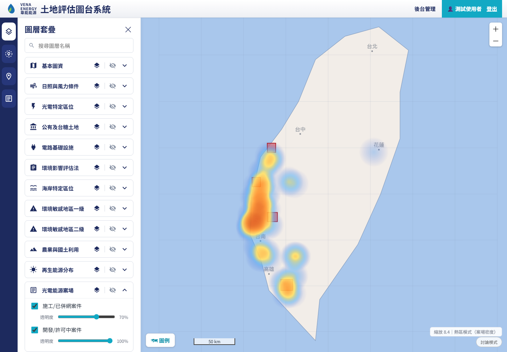

**欄位表**
| 元素 | 欄位名 | 型別 | 必填 | 驗證規則 | 預設值 | 資料來源 | 互動行為 | F |
|------|--------|------|------|----------|--------|----------|----------|---|
| 分類卡片 | 光電能源案場 | 圖層分類 | — | — | 展開 | 系統設定 | 位於圖層套疊分類清單**最後一項**；圖示 `article`；右側為「全部開啟／全部關閉」圖示與展開箭頭（版型比照現有系統）；可展開／收合 | F-01 |
| 圖層 | 施工/已併網案件（面圖層） | 核取方塊＋透明度滑桿 | — | — | 勾選（雛型） | 固定面資料（原能源署核准案場） | 勾選／取消即時顯示／隱藏於地圖；勾選後顯示「透明度」滑桿（沿用既有圖層機制）；唯讀、顏色不調整，待圖資部門確認後上架 | F-01 |
| 圖層 | 開發/許可中案件（點圖層） | 核取方塊＋透明度滑桿 | — | — | 勾選（雛型） | 競合分析管理的全部案場（不分開發階段） | 勾選／取消即時顯示／隱藏；縮小為熱區、放大為點位（見 3.4）；點擊點位開啟資訊視窗（見 3.5） | F-01 |

**業務規則**
- BR-01：點圖層顯示管理清單內**所有**案場，不依開發階段篩選；案場若已併網，由客戶自行在管理清單決定是否刪除。
- BR-02：圖層列不標示多邊形／點的圖示、不標示資料來源；勾選的圖層下方提供「透明度」調整（沿用既有圖層機制）；入口只有左側圖示列。
- BR-03：本分類圖示為 Material Icons Outlined `article`，與左側「競合分析管理」入口相同。
- BR-04：各分類圖示一律為 Material Icons svg，不使用 emoji（圖示清單見附錄 C）。

**例外流程**：無（純勾選操作）。

### 3.2 入口與案場清單（F-02）
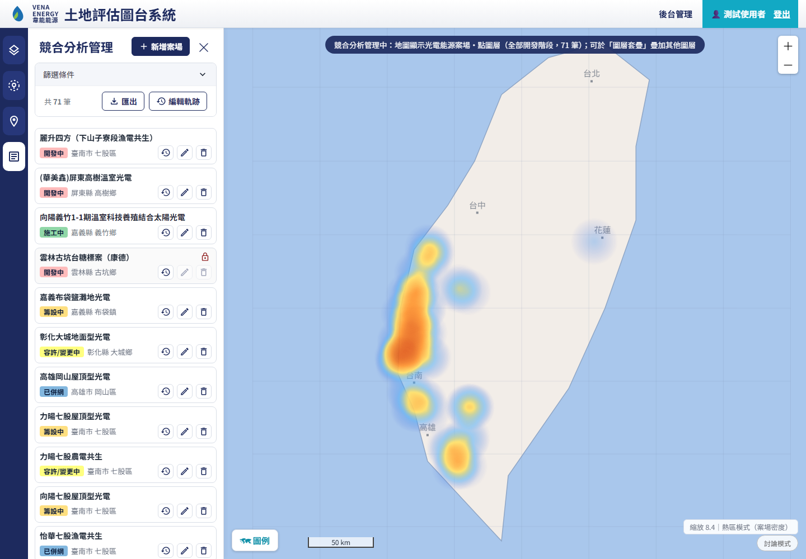

**欄位表**
| 元素 | 欄位名 | 型別 | 必填 | 驗證規則 | 預設值 | 資料來源 | 互動行為 | F |
|------|--------|------|------|----------|--------|----------|----------|---|
| 左側按鈕 | 競合分析管理 | 圖示按鈕 | — | — | 未點擊：白色圖示 | — | 位於圖示列最後一顆（定位工具下方）；懸停顯示「競合分析管理」；點擊進入管理，按鈕呈白底深色圖示 | F-02 |
| 面板 | 標題列 | — | — | — | — | — | 標題「競合分析管理」、「新增案場」按鈕（圖示 `add`＋文字）、✕ 離開管理 | F-02 |
| 卡片 | 篩選條件 | 可收合卡片 | — | — | **收合** | — | 點標題列展開／收合；收合時仍顯示「共 N 筆」「匯出」「編輯軌跡」 | F-02 |
| 清單項目 | 案場名稱 | 文字 | — | — | — | 案場資料 | 粗體 14px；名稱過長時**最後 3 字以「...」取代**，懸停顯示完整名稱 | F-02 |
| 清單項目 | 開發階段標籤 | 標籤 | — | — | — | 案場資料 | 標籤為填滿色（無外框），顏色取地圖圓點原色調淡約 50%：開發中 #febbbb（原色 #fd7878）、籌設中 #fedf80（#fec001）、容許/變更中 #ffff80（#ffff00）、施工中 #90d7a7（#22b050）、已併網 #82b7df（#0570c0）；文字一律深色 #0B1B3A；不顯示 [1]～[5] | F-02 |
| 清單項目 | 縣市 鄉鎮市區 | 文字 | — | — | — | 案場資料 | 與開發階段同一行 | F-02 |
| 清單項目 | 鎖頭 | 圖示 `lock` | — | — | 隱藏 | 鎖定狀態 | 案場被他人鎖定時，顯示於行尾、刪除鈕正上方；不顯示是誰鎖定 | F-04 |
| 清單項目 | 操作鈕 | 圖示按鈕×3 | — | — | — | — | 編輯軌跡（`history`）、編輯（`edit`）、刪除（`delete`）；懸停顯示名稱；被他人鎖定時編輯、刪除不可用 | F-02／F-05 |

**業務規則**
- BR-05：點擊清單項目 → 地圖飛到該案場並放大到點位層級，同時開啟資訊視窗（3.5）。
- BR-06：點「刪除」跳出確認視窗，確認後案場從清單與地圖移除、**不可復原**，僅在編輯軌跡留紀錄。
- BR-07：所有登入且可進入管理的使用者皆可新增、編輯、刪除案場。
- BR-08a：**篩選條件卡片固定在面板上方，捲軸只出現在下方的案場清單**（捲動清單時標題列與篩選條件不動）。
- BR-08：清單排序／分頁：雛型未定義，**【需 PG 確認】**（資料量約 500 筆）。

**例外流程與錯誤訊息**
| 情境 | 系統行為 | 訊息文字（實際文案） |
|------|----------|----------------------|
| 刪除確認 | 跳出視窗，按「取消」關閉、按「確定刪除」刪除 | 標題「刪除案場」；內文「確定刪除「{案場名稱}」？」；說明「案場會從清單與地圖移除；刪除動作會留在編輯軌跡中。刪除後不可復原。」 |
| 刪除完成 | 清單移除、寫入軌跡 | 「已刪除，並寫入編輯軌跡」 |
| 他人鎖定案場按編輯 | 不進入編輯 | 「🔒 {鎖定者} 於 {起始時間} 起正在編輯「{案場名稱}」，請待對方儲存或取消後再編輯」 |
| 已在編輯另一筆時再按編輯 | 不切換 | 「您正在編輯另一筆案場，請先儲存或取消」 |
| 清單完全沒有案場 | 顯示空狀態 | 粗體「目前沒有案場資料」 |
| 篩選後無結果 | 顯示空狀態 | 粗體「無符合查詢結果」＋灰字「請調整查詢條件後再試。」 |

### 3.3 篩選條件（F-02）
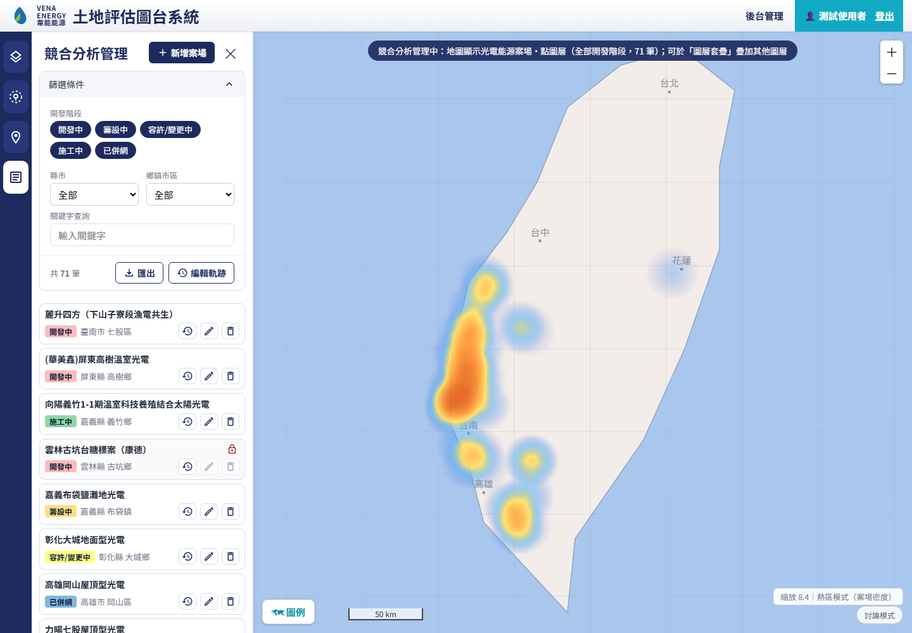

**欄位表**
| 元素 | 欄位名 | 型別 | 必填 | 驗證規則 | 預設值 | 資料來源 | 互動行為 | F |
|------|--------|------|------|----------|--------|----------|----------|---|
| 按鈕組 | 開發階段 | 按鈕式多選 | 否 | — | **5 種全部選取（on）** | 5 種階段 | 點按切換選取／取消；選中為深色底、未選為白底灰字（不套用階段色）；取消的階段不顯示，全部取消則無結果 | F-02 |
| 下拉 | 縣市 | 單選 | 否 | — | 全部 | 22 縣市，由北到南排序：基隆市、臺北市、新北市、桃園市、新竹市、新竹縣、苗栗縣、臺中市、彰化縣、南投縣、雲林縣、嘉義市、嘉義縣、臺南市、高雄市、屏東縣、宜蘭縣、花蓮縣、臺東縣、澎湖縣、金門縣、連江縣 | 選擇後更新鄉鎮市區選項 | F-02 |
| 下拉 | 鄉鎮市區 | 單選 | 否 | — | 全部 | 依縣市連動 | 縣市為「全部」時僅「全部」 | F-02 |
| 輸入框 | 關鍵字查詢 | 文字 | 否 | — | 空 | — | 輸入即時篩選；比對案場名稱、案場編號、光電類型、專區/分區/編訂、土地權屬、集團、公司名稱、備註 | F-02 |
| 文字 | 共 N 筆 | 唯讀 | — | — | — | 篩選結果 | 隨條件即時更新 | F-02 |

**業務規則**
- BR-09：篩選結果同時決定：清單內容、地圖上的點位（管理中）、「匯出」內容、「編輯軌跡」預帶條件。
- BR-10：各條件之間為「且」；開發階段為多選（符合任一已選取階段即顯示）。

### 3.4 地圖：熱區與點位（F-08）

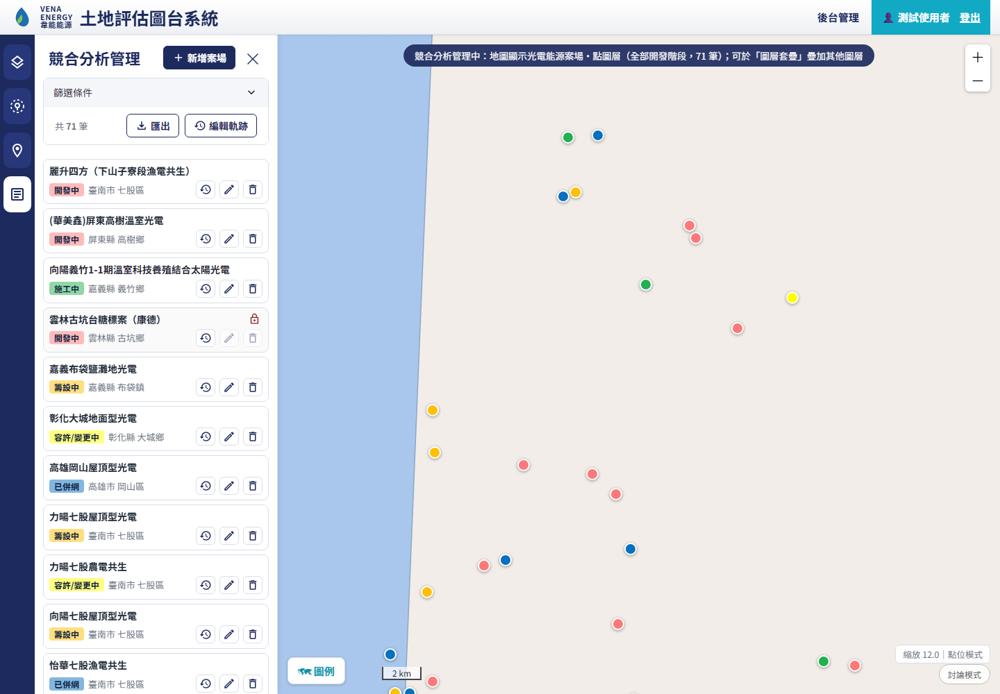

**業務規則**
- BR-12：**熱區（色溫）**：以案場密度呈現，冷色＝稀疏、暖色＝密集，色階 #3B5BDB → #4DABF7 → #FFE066 → #FF922B → #D9480F；權重為案場筆數；熱區半徑隨縮放縮小。
- BR-13：**切換**：縮放 < z10.6（比例尺約 1:35 萬以上）全熱區；z10.6～11.8 熱區與點位淡入淡出；≥ z11.8（約 1:15 萬以下）全點位。畫面右下角顯示目前縮放與模式。切換級數與效果由我方設計，開發可依 Mapbox 實作調整。
- BR-14：**點位樣式為圓點**（直徑約 20px、白色 2px 外框），**顏色依開發階段**：開發中 #fd7878、籌設中 #fec001、容許/變更中 #ffff00、施工中 #22b050、已併網 #0570c0；被他人鎖定的案場圓點降低透明度。未儲存的位置（新增／編輯時的暫存點）仍為粉紅圖釘。
- BR-15：點位上顯示案場名稱標籤；被他人鎖定的點位以淡化＋鎖頭標示。

### 3.5 點位資訊視窗（F-01／F-02）
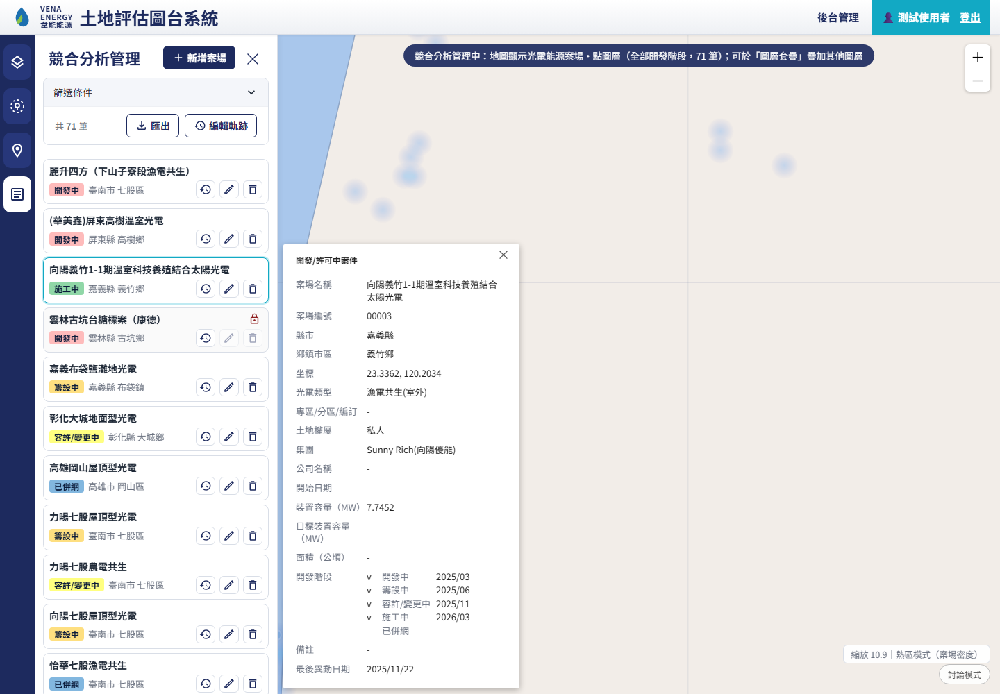

**欄位表（唯讀）**
| 元素 | 欄位名 | 型別 | 必填 | 驗證規則 | 預設值 | 資料來源 | 互動行為 | F |
|------|--------|------|------|----------|--------|----------|----------|---|
| 標題 | 開發/許可中案件 | 文字 | — | — | — | 圖層名稱 | — | F-01 |
| 列 | 案場名稱、案場編號、縣市、鄉鎮市區、坐標、光電類型、專區/分區/編訂、土地權屬 | 文字 | — | — | 無值顯示「-」 | 案場資料 | 唯讀 | F-02 |
| 列 | 集團、公司名稱、開始日期（yyyy/mm） | 文字 | — | — | 無值顯示「-」 | 案場資料 | 唯讀 | F-02 |
| 列 | 裝置容量（MW）、目標裝置容量（MW）、面積（公頃） | 數值 | — | — | 無值顯示「-」 | 案場資料 | 唯讀 | F-02 |
| 列 | 開發階段 | 文字（5 行） | — | — | 依序列出開發中、籌設中、容許/變更中、施工中、已併網：**已達成的前方顯示「v」，未達成顯示「-」（皆為黑色文字，非 emoji）；後方有年月資訊就標上（yyyy/mm）**；版面以三欄對齊（符號｜階段名稱｜年月），年月上下對齊 | 案場資料 | 唯讀 | F-02 |
| 列 | 備註 | 文字 | — | — | 無值顯示「-」 | 案場資料 | 唯讀 | F-02 |
| 列 | 最後異動日期 | 日期 | — | — | 只顯示日期（如 2025/01/08），**不標人員** | 案場資料 | 唯讀 | F-02 |
| 按鈕 | ✕ | 關閉 | — | — | — | — | 關閉視窗 | F-02 |

**業務規則**
- BR-16：版型**以現有系統圖層資訊視窗「公版」為準**（標題＋逐列「欄位名稱／值」），技術開發照公版實作；雛型僅示意。
- BR-17：視窗呈現競合分析管理內的**全部資訊**（案場名稱、開發階段五項、最後異動日期等），坐標不另標坐標系統；**不納入編輯軌跡**，也沒有編輯／刪除／軌跡按鈕。
- BR-18：內容過長時視窗內可捲動；視窗放不下時開在點位下方。

### 3.6 新增案場：設定位置（F-03）
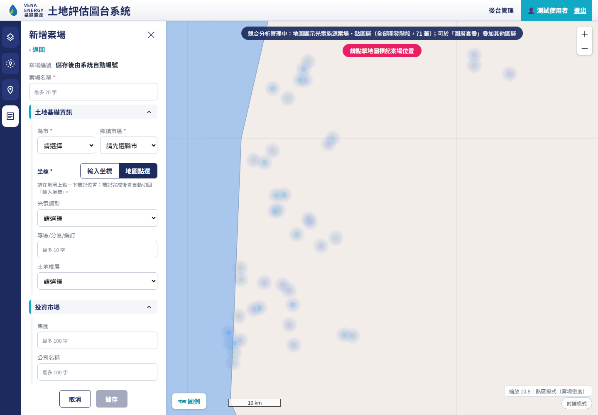
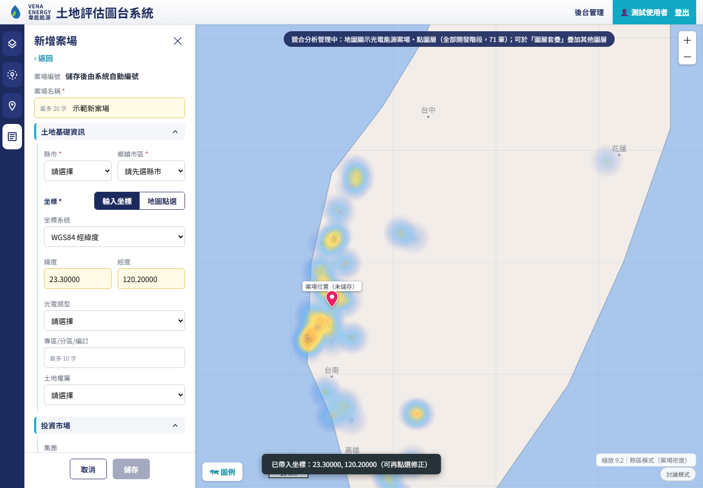

**欄位表**
| 元素 | 欄位名 | 型別 | 必填 | 驗證規則 | 預設值 | 資料來源 | 互動行為 | F |
|------|--------|------|------|----------|--------|----------|----------|---|
| 切換鈕 | 輸入坐標／地圖點選 | 二選一 | 是 | — | 輸入坐標 | — | 選「地圖點選」→ 地圖上方出現提示列「請點擊地圖標記案場位置」；點擊地圖自動帶入坐標，坐標欄位唯讀，可重新點選修正；點擊地圖以外的地方即取消地圖點選（沿用既有機制） | F-03 |
| 下拉 | 坐標系統 | 單選 | 是 | — | WGS84 經緯度 | WGS84 經緯度／TWD97 TM2 121 分帶 | 切換為 TWD97 時欄位標籤改為 X／Y；兩者互相換算 | F-03 |
| 輸入 | 緯度（或 Y） | 數值 | 是 | WGS84：21.7～26.4；TWD97 Y：2400000～2900000 | 空 | 使用者輸入／地圖點選 | 輸入時地圖同步顯示粉紅暫存點 | F-03 |
| 輸入 | 經度（或 X） | 數值 | 是 | WGS84：118.1～122.1；TWD97 X：100000～400000 | 空 | 使用者輸入／地圖點選 | 同上 | F-03 |
| 地圖 | 暫存點 | 粉紅標記 | — | — | — | — | 標籤「案場位置（未儲存）」 | F-03 |

**業務規則**
- BR-19：沒有位置時「儲存」按鈕反灰、不可按。
- BR-20：地圖點選後顯示「已帶入坐標：{緯度}, {經度}（可再點選修正）」，並自動切回「輸入坐標」模式。
- BR-21：坐標限定範圍（WGS84）：緯度須介於 21.7 與 26.4、經度須介於 118.1 與 122.1；TWD97 範圍沿用現有「坐標定位」功能（見附錄 B）。
- BR-21a：**坐標範圍於輸入當下即時判斷**：數值超過上限時，立即自動改為上限值；數值低於下限時，於離開欄位（或按 Enter）時自動改為下限值（輸入中途的未完成數字，如先打「2」再打「23.1」，不會被提早改掉）。自動調整後，在緯度／經度欄位的上一列以紅字提示「{欄位}需介於 {下限}～{上限}」，該欄改回範圍內數值後提示消失；調整後的值同步更新地圖暫存點。

**例外流程與錯誤訊息**
| 情境 | 系統行為 | 訊息文字（實際文案） |
|------|----------|----------------------|
| 坐標未填完整 | 「儲存」按鈕反灰、不可按 | —（防呆備援文案：「請輸入完整的坐標（緯度、經度）」；TWD97：「請輸入完整的坐標（Y、X 坐標）」） |
| 緯度超出範圍 | 超過上限立即改為 26.4、低於下限於離開欄位時改為 21.7 | 緯度／經度欄位的上一列：「緯度需介於 21.7～26.4」 |
| 經度超出範圍 | 超過上限立即改為 122.1、低於下限於離開欄位時改為 118.1 | 「經度需介於 118.1～122.1」 |
| TWD97 X 超出範圍 | 同上（上限 400000／下限 100000） | 「X 坐標需介於 100000～400000」 |
| TWD97 Y 超出範圍 | 同上（上限 2900000／下限 2400000） | 「Y 坐標需介於 2400000～2900000」 |
| 沒有設定位置 | 「儲存」按鈕反灰、不可按 | —（防呆備援文案：「請設定案場位置：輸入坐標，或在地圖上點選」） |

### 3.7 編輯案場（F-03）
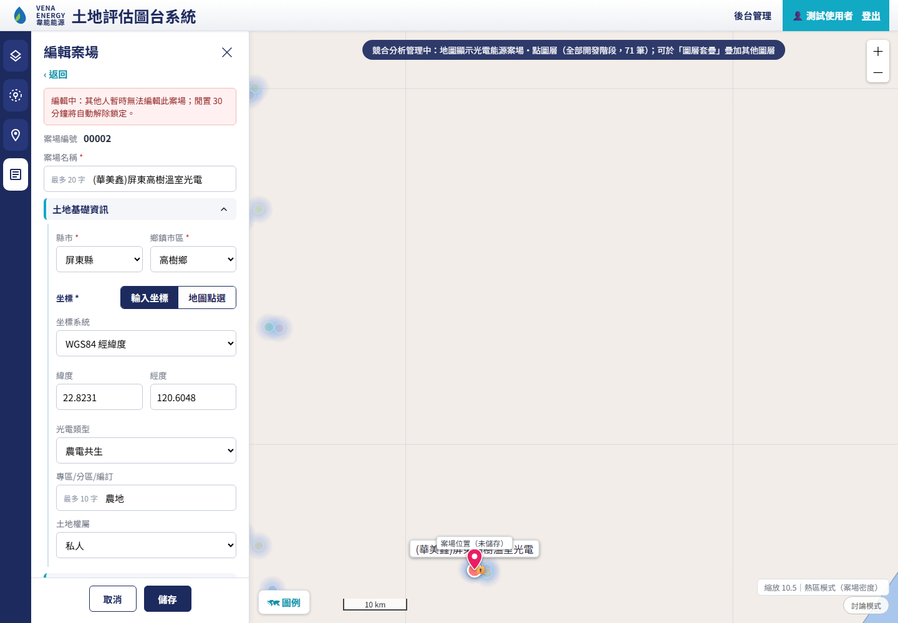
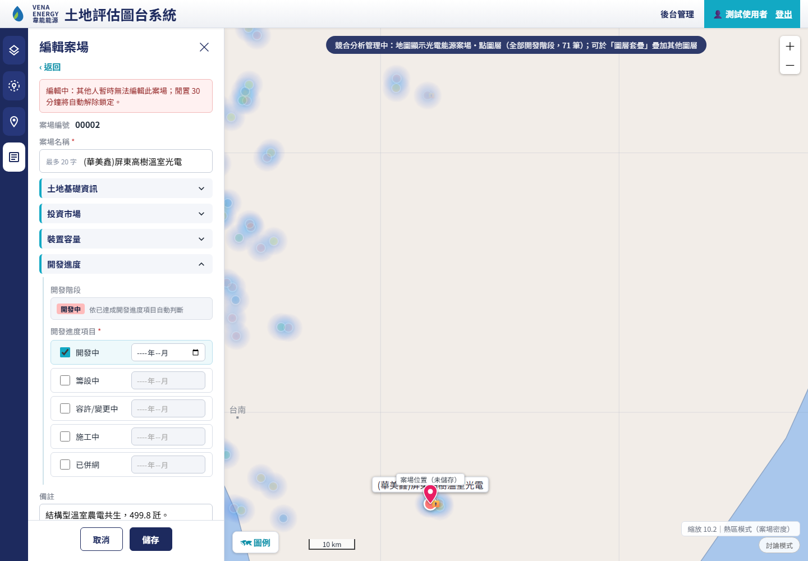

**欄位表**（分類可收合；案場編號、案場名稱、備註不屬任何分類、不收合）
| 元素 | 欄位名 | 型別 | 必填 | 驗證規則 | 預設值 | 資料來源 | 互動行為 | F |
|------|--------|------|------|----------|--------|----------|----------|---|
| 唯讀 | 案場編號 | 文字 | — | 系統產生：5 碼流水號（00001 起）；建立後不變、刪除後不重用 | 新增時顯示「儲存後由系統自動編號」 | 系統 | 不可編輯 | F-03 |
| 輸入 | 案場名稱 | 文字 | 是 | 最多 20 字 | 空 | 使用者輸入 | 輸入框內左側固定顯示「最多 20 字」；輸入達 20 字時，標題後才另外出現「最多 20 字」註記；超過上限無法再輸入 | F-03 |
| 下拉 | 縣市 | 單選 | 是 | 22 縣市：基隆市、臺北市、新北市、桃園市、新竹市、新竹縣、苗栗縣、臺中市、彰化縣、南投縣、雲林縣、嘉義市、嘉義縣、臺南市、高雄市、屏東縣、宜蘭縣、花蓮縣、臺東縣、澎湖縣、金門縣、連江縣 | 請選擇 | 選單 | 自選，不以坐標自動判斷 | F-03 |
| 下拉 | 鄉鎮市區 | 單選 | 是 | 依縣市連動 | 請先選縣市 | 選單 | 自選，不以坐標自動判斷 | F-03 |
| 坐標組 | 坐標 | 見 3.6 | 是 | 見 3.6 | — | — | 見 3.6 | F-03 |
| 下拉 | 光電類型 | 單選 | 否 | 水面型、農電共生、漁電共生(室外)、地面型、漁電共生(室內)、屋頂型 | 請選擇 | 選單 | — | F-03 |
| 輸入 | 專區/分區/編訂 | 文字 | 否 | 最多 10 字 | 空 | 使用者輸入 | 輸入框內左側固定顯示「最多 10 字」；輸入達 10 字時，標題後才另外出現「最多 10 字」註記；超過上限無法再輸入 | F-03 |
| 下拉 | 土地權屬 | 單選 | 否 | 私人、國產署、台糖、工業局、地方政府 | 請選擇 | 選單 | — | F-03 |
| 輸入 | 集團 | 文字 | 否 | 最多 100 字 | 空 | 使用者輸入 | 輸入框內左側固定顯示「最多 100 字」；輸入達 100 字時，標題後才另外出現「最多 100 字」註記；超過上限無法再輸入 | F-03 |
| 輸入 | 公司名稱 | 文字 | 否 | 最多 100 字 | 空 | 使用者輸入 | 輸入框內左側固定顯示「最多 100 字」；輸入達 100 字時，標題後才另外出現「最多 100 字」註記；超過上限無法再輸入 | F-03 |
| 年月 | 開始日期 | 年月 | 否 | 只記到年月（yyyy/mm） | 空 | 使用者輸入 | — | F-03 |
| 輸入 | 裝置容量（MW） | 數值 | 否 | 數值、不小於 0；單位統一為 MW | 空 | 使用者輸入 | — | F-03 |
| 輸入 | 目標裝置容量（MW） | 數值 | 否 | 數值、不小於 0；單位 MW | 空 | 使用者輸入 | — | F-03 |
| 輸入 | 面積（公頃） | 數值 | 否 | 數值、不小於 0 | 空 | 使用者輸入 | — | F-03 |
| 唯讀 | 開發階段 | 標籤 | — | 由開發進度項目自動判斷，不可手動修改 | 依已勾選項目 | 系統 | 取已勾選項目中最後一項；未勾選顯示「—」 | F-03 |
| 勾選＋年月 | 開發進度項目（5 項） | 核取方塊＋年月 | **至少勾選 1 項** | 開發中、籌設中、容許/變更中、施工中、已併網；各項年月只記到年月、選填 | 全不勾 | 使用者輸入 | 勾選後該項年月可填；取消勾選年月停用 | F-03 |
| 輸入 | 備註 | 多行文字 | 否 | 最多 500 字 | 空 | 使用者輸入 | 輸入框內左側固定顯示「最多 500 字」；輸入達 500 字時，標題後才另外出現「最多 500 字」註記；超過上限無法再輸入 | F-03 |
| 按鈕 | 取消／儲存 | — | — | **必填欄位未全部填妥時，「儲存」按鈕反灰、不可按** | 新增時反灰 | — | 必填：案場名稱、縣市、鄉鎮市區、坐標、至少勾選一項開發進度；全部填妥後「儲存」可按 | F-03 |

**業務規則**
- BR-22：所有文字輸入框的標題後與輸入框內（placeholder）都預設顯示「最多 X 字」提示，超過上限無法再輸入。
- BR-22a：必填欄位（案場名稱、縣市、鄉鎮市區、坐標、至少一項開發進度）未全部填妥時，「儲存」按鈕反灰不可按；填妥後才可按。
- BR-23：開發階段取「已勾選開發進度項目中最後一項」（依順序：開發中 < 籌設中 < 容許/變更中 < 施工中 < 已併網）。
- BR-24：儲存時若與原資料無差異：不寫入軌跡、解除鎖定。
- BR-25：新增儲存成功 → 寫入軌跡「新增」；編輯儲存成功 → 寫入軌跡「編輯」（欄位前後值）。
- BR-26：未儲存離開（取消／離開管理）→ 放棄變更並解除鎖定。

**例外流程與錯誤訊息**
| 情境 | 系統行為 | 訊息文字（實際文案） |
|------|----------|----------------------|
| 必填欄位留空 | 「儲存」按鈕反灰、不可按；補齊後才可按 | —（防呆備援文案：「請填寫「案場名稱」」「請填寫「縣市」」「請填寫「鄉鎮市區」」） |
| 數值欄位填入非數字 | 不儲存 | 「「裝置容量（MW）」需為數字」（目標裝置容量、面積同） |
| 坐標／位置問題 | 不儲存 | 見 3.6 |
| 一項開發進度都沒勾 | 「儲存」按鈕反灰、不可按 | —（防呆備援文案：「請至少勾選一項開發進度項目」） |
| 無變更儲存 | 解除鎖定、不寫軌跡 | 「沒有任何變更，已解除鎖定」 |
| 新增成功 | 回清單、寫入軌跡 | 「已新增案場並寫入編輯軌跡」 |
| 編輯成功 | 回清單、寫入軌跡 | 「已儲存 {N} 項變更並寫入編輯軌跡」 |
| 編輯中離開管理 | 跳出確認 | 標題「尚有編輯中的案場」；「離開管理將放棄未儲存的變更，並解除「{案場名稱}」的鎖定。」；按鈕「繼續編輯」「放棄並離開」 |

### 3.8 共編鎖定與閒置提醒（F-04）
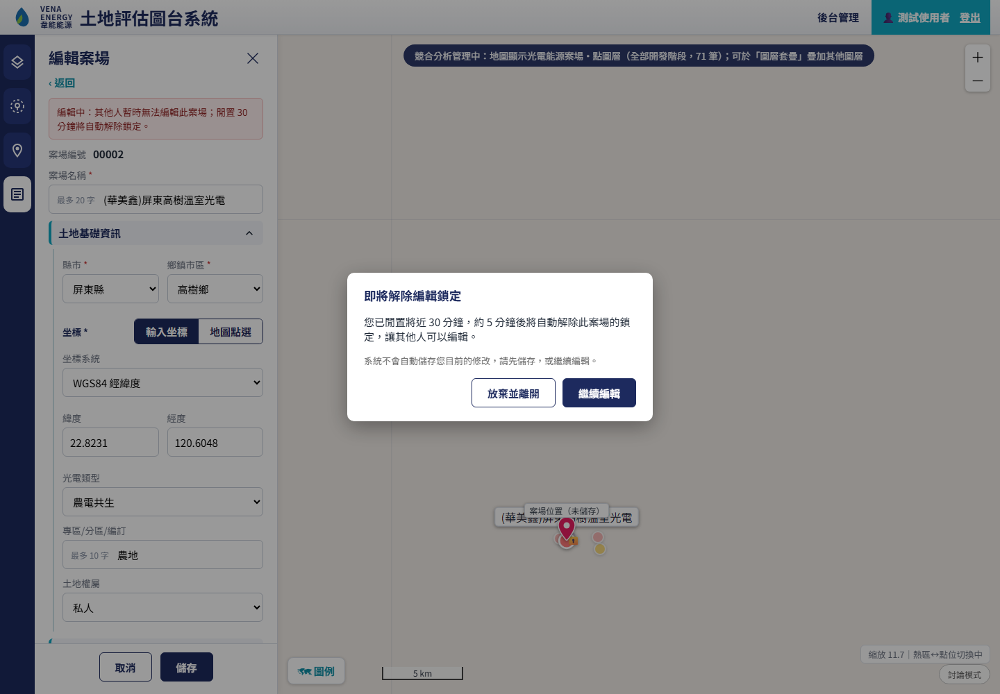

**業務規則**
- BR-27：鎖定單位為「單一案場」：A 編輯某案場時，該案場對他人唯讀（編輯、刪除不可用，清單顯示鎖頭，不顯示是誰鎖定）；其他案場不受影響。
- BR-28：釋放條件：儲存、取消、離開管理（放棄）、閒置逾時自動解除。**不提供管理者強制解鎖。**
- BR-29：閒置 30 分鐘自動解除；解除前 5 分鐘跳出提醒；**不自動存檔**。
- BR-30：編輯畫面頂端顯示提示「編輯中：其他人暫時無法編輯此案場；閒置 30 分鐘將自動解除鎖定。」
- BR-31：鎖定狀態如何即時同步（他人鎖定多快反映在清單）：**【待技術確認】**（Q-09）。

**例外流程與錯誤訊息**
| 情境 | 系統行為 | 訊息文字（實際文案） |
|------|----------|----------------------|
| 閒置剩 5 分鐘 | 跳出視窗 | 標題「即將解除編輯鎖定」；「您已閒置將近 30 分鐘，約 5 分鐘後將自動解除此案場的鎖定，讓其他人可以編輯。」；「系統不會自動儲存您目前的修改，請先儲存，或繼續編輯。」；按鈕「放棄並離開」「繼續編輯」 |

### 3.9 編輯軌跡（F-05）
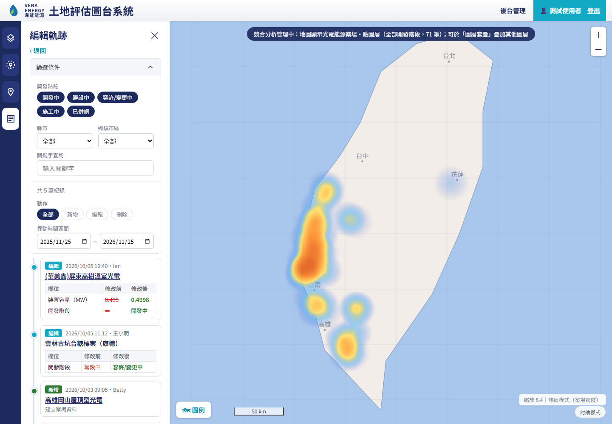
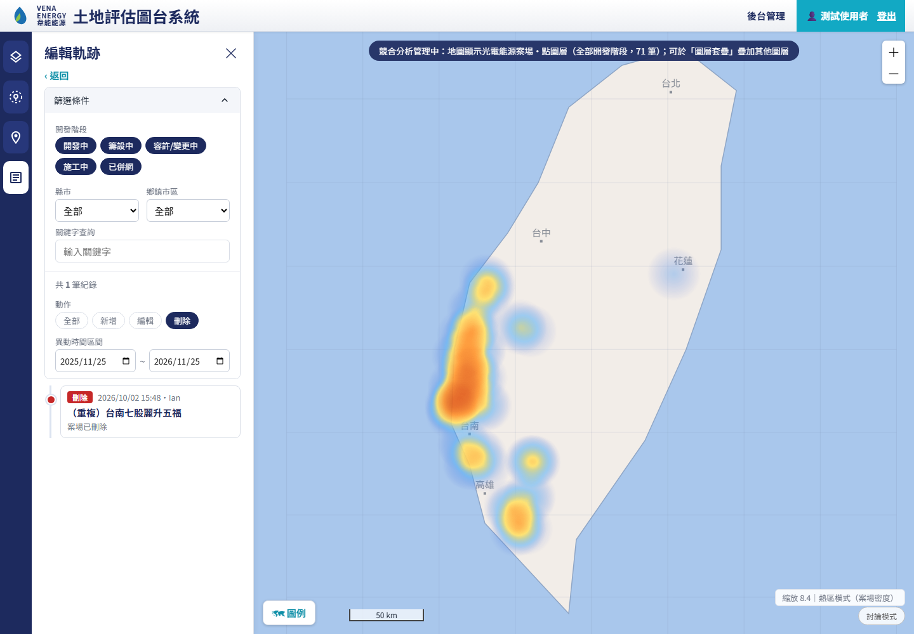
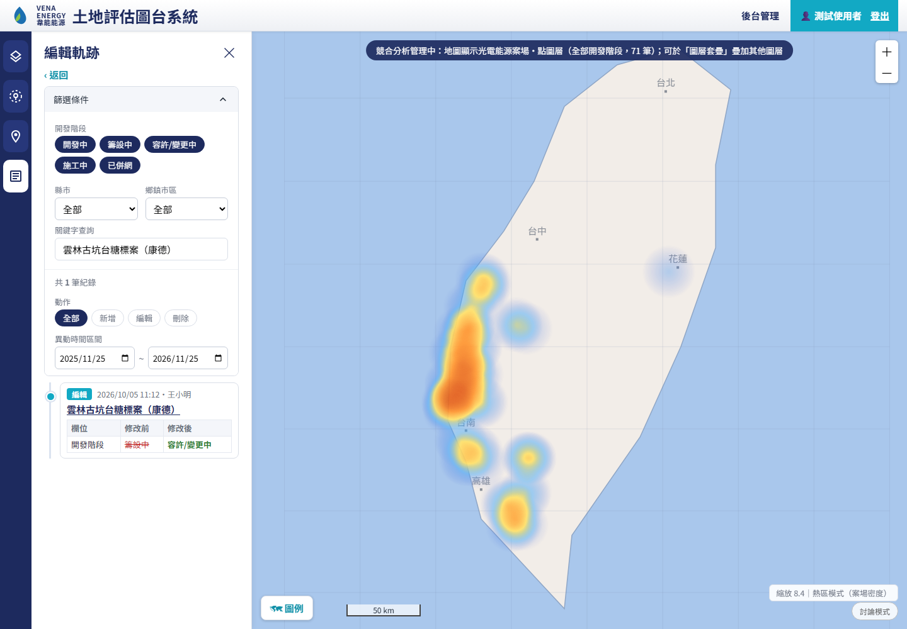

**欄位表**
| 元素 | 欄位名 | 型別 | 必填 | 驗證規則 | 預設值 | 資料來源 | 互動行為 | F |
|------|--------|------|------|----------|--------|----------|----------|---|
| 篩選卡片 | 開發階段／縣市／鄉鎮市區／關鍵字 | 同 3.3（開發階段預設 5 種全選） | 否 | — | 從清單進入：預帶清單條件；從單一案場進入：以案場名稱帶入關鍵字 | — | 卡片預設展開 | F-05 |
| 按鈕組 | 動作 | 單選 | 否 | 全部／新增／編輯／刪除 | 全部 | — | 篩選紀錄的動作類型 | F-05 |
| 日期 | 異動時間區間（起～迄） | 日期 | 否 | 起不得晚於迄 | **近 1 年**（起＝今日往前一年、迄＝今日） | — | 可自行調整 | F-05 |
| 時間軸 | 紀錄 | 清單 | — | — | 新到舊 | 軌跡資料 | 每筆顯示動作、時間、操作者、案場名稱；編輯時顯示「欄位／修改前／修改後」 | F-05 |
| 連結 | 案場名稱 | 連結 | — | — | — | — | 點擊進入該案場編輯頁（案場仍存在時） | F-05 |

**業務規則**
- BR-32：新增、儲存編輯、刪除時產生軌跡；編輯紀錄**欄位修改前後值**。
- BR-33：**所有軌跡全部保留**，不自動刪除。
- BR-34：已刪除案場的軌跡保留，**不保留當時的縣市／開發階段快照**（客戶已確認）：這類軌跡可用關鍵字（案場名稱）、時間、動作查到；選了縣市、鄉鎮市區，或取消任一開發階段的選取時，不會列出。
- BR-34a：「刪除」紀錄顯示動作標籤「刪除」、時間、操作者、案場名稱與「案場已刪除」（見截圖，動作選「刪除」）。
- BR-35：進入方式：清單單筆 ⏱、編輯畫面內嵌「此案場編輯軌跡」、篩選卡片底部「編輯軌跡」。

**例外流程**
| 情境 | 系統行為 | 訊息文字（實際文案） |
|------|----------|----------------------|
| 篩選後沒有紀錄 | 顯示空狀態 | 「沒有符合條件的紀錄」 |

### 3.10 匯出（F-06）
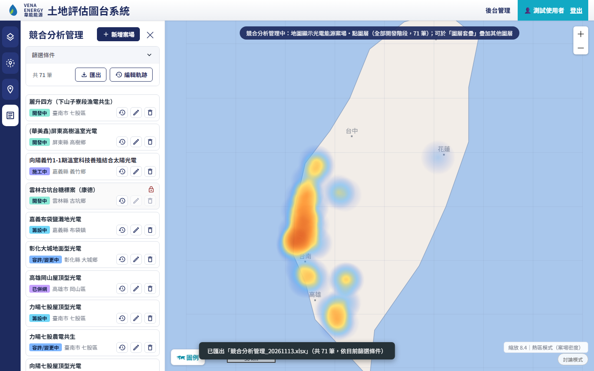
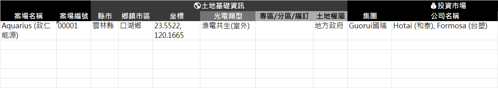
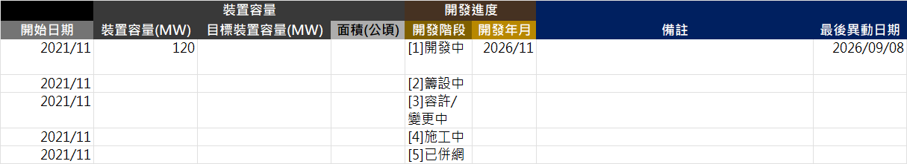

**業務規則**
- BR-36：點「匯出」直接產出 Excel，檔名「競合分析管理_yyyymmdd.xlsx」；範圍為清單目前篩選條件的結果；**匯出動作不需紀錄**。
- BR-37：匯出欄位與格式如範本檔 `03_規格文件/競合分析管理_YYMMDD.xlsx`（18 欄，依序）：案場名稱、案場編號、縣市、鄉鎮市區、坐標、光電類型、專區/分區/編訂、土地權屬、集團、公司名稱、開始日期、裝置容量(MW)、目標裝置容量(MW)、面積(公頃)、開發階段、開發年月、備註、最後異動日期。
- BR-38：**坐標只匯出 WGS84**，單欄「緯度, 經度」。
- BR-39：**開發階段在 Excel 加 [1]～[5] 標示**（[1]開發中、[2]籌設中、[3]容許/變更中、[4]施工中、[5]已併網）；系統畫面不加。
- BR-40：**開發年月**以「最後階段」（＝目前開發階段）的年月顯示；若前面階段有年月、但目前階段沒有，則開發年月留白。
- BR-41：日期欄（開始日期、開發年月、最後異動日期）顯示 yyyy/mm；案場編號為文字格式（保留前導 0）；列高依文字長度自動換行。

**例外流程與錯誤訊息**
| 情境 | 系統行為 | 訊息文字（實際文案） |
|------|----------|----------------------|
| 匯出成功 | 下載檔案、顯示提示 | 「已匯出「競合分析管理_yyyymmdd.xlsx」（共 {N} 筆，依目前篩選條件）」 |

### 3.11 管理中的圖層套疊（F-07）
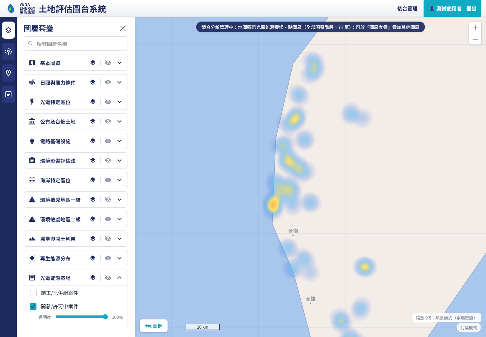
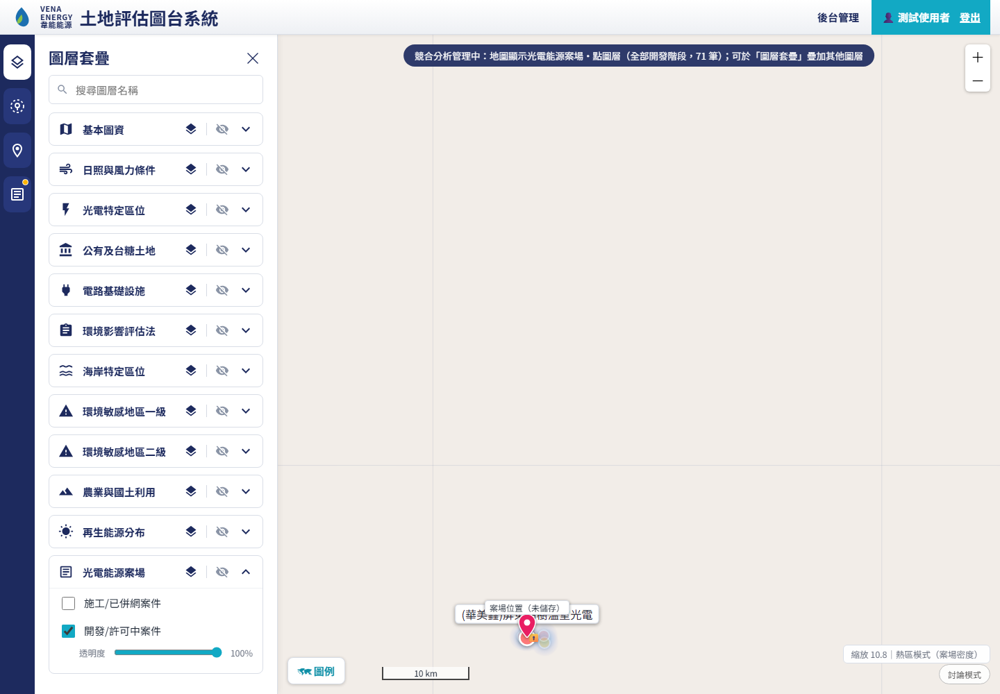

**業務規則**
- BR-42：競合分析管理使用中，「光電能源案場」兩個圖層**不鎖定**，可自由勾選切換；進入管理不自動取消勾選，離開管理也不還原。
- BR-43：管理中：點圖層勾選＝地圖顯示管理清單點位（受清單篩選影響），取消＝隱藏點位；面圖層勾選＝顯示施工/已併網多邊形。
- BR-44：進入管理時若點圖層未勾，自動勾上。
- BR-45：管理中仍可從圖層套疊疊其他分類，供編輯時對照。
- BR-46：進入管理後離開（✕）顯示「已離開競合分析管理」。
- BR-47：**編輯狀態下切換到其他頁籤**（如圖層套疊）時，左側「競合分析管理」按鈕右上角顯示**橘色圓點**，提示仍有編輯中的案場（鎖定保留）；回到管理後圓點消失。

---

## 四、權限與資料範圍
| 角色 | 可用操作 | 資料範圍 |
|------|----------|----------|
| 登入且可進入管理的使用者（韋能同仁） | 檢視圖層、新增／編輯／刪除案場、查看編輯軌跡、匯出 | 全部案場；面圖層（施工/已併網）為唯讀固定資料 |
| 未登入或無管理權限者 | 無法進入競合分析管理 | 僅依既有圖層套疊權限看到圖層（**【需 PG 確認】**：無權限者是否看得到「光電能源案場」分類） |

> 審核確認功能已取消；不區分角色（所有可進入管理者皆可新增、編輯、刪除）。

## 五、非功能需求
- 資料量級：約 520 筆案場（舊資料），共編者多人；熱區與點位需順暢縮放（正式版 Mapbox GL）。
- 鎖定：單一案場鎖定、閒置 30 分鐘解除（即時同步方式待技術確認）。
- 編輯軌跡：全部保留，不設保存期限。
- 匯出：範圍為篩選結果；大量資料匯出行為（逾時、筆數上限）**【需 PG 確認】**。
- 雛型為離線示意（簡化底圖、假資料），不代表正式效能。

## 六、驗收條件（AC）— PG 自測與 PM 驗收共用
> PG 交付前逐項自測勾「PG自測」，全勾才交 PM；PM 驗收勾「PM驗收」。
> 不通過的在備註寫清楚現象：是 bug → PG 修復後複測；是需求認知差異或客戶改需求 → 回 /req-intake 從雛型改起。

| AC | 類別 | 對應 F | Given（前置） | When（操作） | Then（預期結果） | PG自測 | PM驗收 | 備註 |
|----|------|--------|---------------|--------------|------------------|--------|--------|------|
| AC-01 | 主流程 | F-01 | 已登入，開啟圖層套疊 | 檢視分類清單 | 「光電能源案場」為最後一項，圖示為 article，底下有「施工/已併網案件」「開發/許可中案件」兩個圖層，圖層列沒有多邊形／點圖示 | ☐ | ☐ | |
| AC-02 | 主流程 | F-01 | 兩個圖層皆未勾 | 勾選「開發/許可中案件」 | 地圖顯示管理清單內全部案場（含施工中、已併網階段）；取消勾選即隱藏 | ☐ | ☐ | |
| AC-03 | 主流程 | F-01 | 兩個圖層皆未勾 | 勾選「施工/已併網案件」 | 地圖顯示面資料多邊形，且無法編輯 | ☐ | ☐ | |
| AC-04 | 主流程 | F-02 | 已登入 | 點左側圖示列「競合分析管理」按鈕 | 按鈕位於定位工具下方，進入後呈白底深色圖示，篩選條件為收合狀態 | ☐ | ☐ | |
| AC-05 | 主流程 | F-02 | 左側選單 | 滑鼠移到「競合分析管理」按鈕 | 顯示提示「競合分析管理」 | ☐ | ☐ | |
| AC-06 | 主流程 | F-02 | 清單有案場，其中一筆名稱超過可顯示寬度 | 檢視清單 | 該筆名稱最後 3 字以「...」取代；滑鼠懸停顯示完整名稱 | ☐ | ☐ | |
| AC-06a | 主流程 | F-02 | 清單有案場（各開發階段至少一筆） | 檢視清單每筆的開發階段標籤 | 標籤只顯示階段名稱（如「開發中」「施工中」），不含 [1]～[5] 編號；編號僅 Excel 匯出才加（如「[1]開發中」） | ☐ | ☐ | |
| AC-07 | 主流程 | F-02 | 清單有案場 | 點擊清單中一筆 | 地圖飛到該案場、放大到點位層級並開啟資訊視窗 | ☐ | ☐ | |
| AC-08 | 主流程 | F-02 | 篩選條件收合 | 查看卡片 | 仍顯示「共 N 筆」「匯出」「編輯軌跡」；點標題列可展開 | ☐ | ☐ | |
| AC-08a | 主流程 | F-02 | 篩選條件展開 | 檢視開發階段按鈕與縣市下拉 | 5 個開發階段按鈕預設全為選取（on）；縣市選單由北到南依序為基隆市、臺北市、新北市、桃園市、新竹市、新竹縣、苗栗縣、臺中市、彰化縣、南投縣、雲林縣、嘉義市、嘉義縣、臺南市、高雄市、屏東縣、宜蘭縣、花蓮縣、臺東縣、澎湖縣、金門縣、連江縣 | ☐ | ☐ | |
| AC-08b | 主流程 | F-02 | 清單案場多到超出面板高度 | 向下捲動清單 | 標題列與篩選條件卡片固定在上方不動，捲軸只在下方清單區出現，整個面板不隨之捲動 | ☐ | ☐ | |
| AC-09 | 主流程 | F-02 | 篩選條件展開，5 個階段全選 | 取消「開發中」「籌設中」「容許/變更中」，只留「施工中」「已併網」 | 清單與地圖只顯示這兩階段的案場，「共 N 筆」同步更新；全部取消則無結果 | ☐ | ☐ | |
| AC-10 | 主流程 | F-02 | 篩選條件展開 | 縣市選「臺南市」 | 鄉鎮市區選項變為臺南市所屬；清單只剩臺南市案場 | ☐ | ☐ | |
| AC-11 | 主流程 | F-02 | 篩選條件展開 | 關鍵字輸入某案場的備註片段 | 清單即時只顯示備註含該片段的案場 | ☐ | ☐ | |
| AC-12 | 例外 | F-02 | 篩選條件展開 | 縣市選「連江縣」、開發階段選「已併網」且無符合案場 | 清單顯示粗體「無符合查詢結果」與灰字「請調整查詢條件後再試。」 | ☐ | ☐ | |
| AC-13 | 例外 | F-02 | 尚無任何案場 | 進入競合分析管理 | 顯示粗體「目前沒有案場資料」 | ☐ | ☐ | |
| AC-14 | 主流程 | F-08 | 縮放小於 z10.6 | 檢視地圖 | 顯示色溫熱區（稀疏冷色、密集暖色），不顯示個別點位 | ☐ | ☐ | |
| AC-15 | 主流程 | F-08 | 縮放大於 z11.8 | 檢視地圖 | 顯示個別圓點，顏色依開發階段（開發中 #fd7878、籌設中 #fec001、容許/變更中 #ffff00、施工中 #22b050、已併網 #0570c0） | ☐ | ☐ | |
| AC-16 | 主流程 | F-08 | 縮放介於 z10.6～11.8 | 縮放地圖 | 熱區與點位淡入淡出過渡，無閃爍 | ☐ | ☐ | |
| AC-17 | 主流程 | F-08 | 地圖顯示中 | 拖曳、滾輪、＋－、雙擊 | 地圖可平移與縮放 | ☐ | ☐ | |
| AC-18 | 主流程 | F-01 | 大比例尺，地圖顯示點位 | 點擊一個點位 | 開啟公版樣式資訊視窗，標題「開發/許可中案件」，逐列顯示名稱、案場編號、縣市、鄉鎮市區、坐標、光電類型、專區/分區/編訂、土地權屬、集團、公司名稱、開始日期、裝置容量、目標裝置容量、面積、開發階段、五項進度、備註、最後異動 | ☐ | ☐ | |
| AC-19 | 驗證 | F-01 | 開啟某案場資訊視窗（該案場公司名稱未填） | 檢視「公司名稱」 | 顯示「-」；坐標列不出現「WGS84」字樣；第一列標題為「案場名稱」 | ☐ | ☐ | |
| AC-19a | 主流程 | F-01 | 案場開發中已勾選（年月 2025/06）、籌設中未勾 | 開啟資訊視窗檢視「開發階段」 | 依序列出五項：「v 開發中 2025/06」「- 籌設中」「- 容許/變更中」「- 施工中」「- 已併網」；已達成者前方為黑色文字「v」、未達成為黑色文字「-」，均非 emoji，有年月者後方標年月 | ☐ | ☐ | |
| AC-19b | 主流程 | F-01 | 案場最後異動為 2025/01/08 | 檢視「最後異動日期」 | 只顯示「2025/01/08」，不顯示人員 | ☐ | ☐ | |
| AC-19c | 主流程 | F-01 | 勾選「開發/許可中案件」 | 檢視圖層列下方 | 出現「透明度」滑桿；拖曳後地圖上的熱區／點位透明度隨之改變（沿用既有圖層機制）；「施工/已併網案件」勾選後亦有透明度滑桿 | ☐ | ☐ | |
| AC-20 | 權限 | F-01 | 開啟資訊視窗 | 檢視視窗按鈕 | 只有 ✕，沒有編輯、刪除、編輯軌跡按鈕，視窗內也沒有軌跡資料 | ☐ | ☐ | |
| AC-21 | 主流程 | F-03 | 在競合分析管理 | 按「新增案場」 | 進入新增頁，案場編號顯示「儲存後由系統自動編號」，開發階段顯示「—」，所有文字輸入框內左側固定顯示「最多 X 字」（標題後此時不顯示註記），「儲存」按鈕反灰 | ☐ | ☐ | |
| AC-22 | 主流程 | F-03 | 新增頁 | 填案場名稱「測試案場」、縣市臺南市、鄉鎮市區七股區，切「地圖點選」並點地圖，勾「開發中」，按儲存 | 提示「已帶入坐標：…（可再點選修正）」，儲存後提示「已新增案場並寫入編輯軌跡」，清單出現該案場，編號為下一個 5 碼流水號（如 00072） | ☐ | ☐ | |
| AC-23 | 主流程 | F-03 | 新增頁 | 選「輸入坐標」，緯度 23.1557、經度 120.0982 | 地圖出現粉紅暫存點，標籤「案場位置（未儲存）」 | ☐ | ☐ | |
| AC-23a | 主流程 | F-03 | 新增頁，已選「地圖點選」（地圖上方有提示列） | 點擊地圖以外的地方（如左側面板空白處） | 取消地圖點選，提示列消失、切回「輸入坐標」；坐標維持原值 | ☐ | ☐ | |
| AC-24 | 主流程 | F-03 | 新增頁，坐標系統 WGS84 | 切換為 TWD97 | 坐標欄位標籤改為 X／Y | ☐ | ☐ | |
| AC-25 | 驗證 | F-03 | 新增頁，其他必填已填 | 案場名稱留空 | 「儲存」按鈕反灰、不可按；填入名稱後可按 | ☐ | ☐ | |
| AC-26 | 驗證 | F-03 | 新增頁，其他必填已填 | 縣市留空 | 「儲存」按鈕反灰、不可按 | ☐ | ☐ | |
| AC-27 | 驗證 | F-03 | 新增頁，其他必填已填 | 鄉鎮市區留空 | 「儲存」按鈕反灰、不可按 | ☐ | ☐ | |
| AC-28 | 驗證 | F-03 | 新增頁，其他必填已填、未設定位置（坐標空白） | 檢視儲存按鈕 | 「儲存」按鈕反灰、不可按 | ☐ | ☐ | |
| AC-29 | 驗證 | F-03 | 新增頁，輸入坐標模式 | 緯度輸入 21.6 後離開欄位 | 欄位自動改為 21.7，緯度／經度欄位上一列以紅字提示「緯度需介於 21.7～26.4」 | ☐ | ☐ | |
| AC-30 | 驗證 | F-03 | 新增頁，輸入坐標模式 | 緯度輸入 26.5（尚未離開欄位） | 輸入當下立即改為 26.4，緯度／經度欄位上一列以紅字提示「緯度需介於 21.7～26.4」 | ☐ | ☐ | |
| AC-31 | 驗證 | F-03 | 新增頁，輸入坐標模式 | 經度輸入 118.0 後離開欄位 | 欄位自動改為 118.1，緯度／經度欄位上一列以紅字提示「經度需介於 118.1～122.1」 | ☐ | ☐ | |
| AC-32 | 驗證 | F-03 | 新增頁，輸入坐標模式 | 經度輸入 122.2 | 輸入當下立即改為 122.1，緯度／經度欄位上一列以紅字提示「經度需介於 118.1～122.1」 | ☐ | ☐ | |
| AC-33 | 驗證 | F-03 | 新增頁，緯度 21.7、經度 118.1（邊界值） | 離開欄位並按儲存 | 數值不被調整、無紅字提示，通過坐標檢核（可儲存） | ☐ | ☐ | |
| AC-34 | 驗證 | F-03 | 新增頁，坐標系統 TWD97 | X 輸入 99999 後離開欄位 | 自動改為 100000，緯度／經度欄位上一列以紅字提示「X 坐標需介於 100000～400000」 | ☐ | ☐ | |
| AC-35 | 驗證 | F-03 | 新增頁，坐標系統 TWD97，Y 為 2899999 | 將 Y 改為 2900001 | 輸入當下立即改為 2900000，緯度／經度欄位上一列以紅字提示「Y 坐標需介於 2400000～2900000」 | ☐ | ☐ | |
| AC-35a | 驗證 | F-03 | 新增頁，緯度已被自動調整並顯示紅字提示 | 將緯度改成範圍內數值（如 23.1557） | 紅字提示消失；地圖暫存點隨坐標更新 | ☐ | ☐ | |
| AC-36 | 驗證 | F-03 | 新增頁，緯度或經度留空 | 檢視儲存按鈕 | 「儲存」按鈕反灰、不可按 | ☐ | ☐ | |
| AC-37 | 驗證 | F-03 | 新增頁，必填與位置已填，開發進度一項都沒勾 | 檢視儲存按鈕；再勾選任一項 | 「儲存」按鈕反灰、不可按；勾選任一項後可按 | ☐ | ☐ | |
| AC-38 | 驗證 | F-03 | 編輯頁 | 案場名稱輸入第 21 個字 | 無法輸入（上限 20 字）；此時標題後才出現「最多 20 字」註記；刪到 19 字註記消失 | ☐ | ☐ | |
| AC-39 | 驗證 | F-03 | 編輯頁 | 專區/分區/編訂輸入第 11 個字 | 無法輸入（上限 10 字），為文字輸入非下拉 | ☐ | ☐ | |
| AC-40 | 驗證 | F-03 | 編輯頁 | 集團、公司名稱各輸入第 101 個字 | 無法輸入（上限 100 字） | ☐ | ☐ | |
| AC-41 | 驗證 | F-03 | 編輯頁 | 備註輸入第 501 個字 | 無法輸入（上限 500 字） | ☐ | ☐ | |
| AC-42 | 驗證 | F-03 | 編輯頁 | 裝置容量輸入「abc」按儲存 | 不儲存，提示「「裝置容量（MW）」需為數字」 | ☐ | ☐ | |
| AC-43 | 驗證 | F-03 | 編輯頁 | 裝置容量輸入 -1 | 不允許小於 0 的值 | ☐ | ☐ | |
| AC-44 | 主流程 | F-03 | 編輯頁，開發進度全不勾 | 依序勾「開發中」「籌設中」「施工中」 | 開發階段自動變為「施工中」（取最後一項），不可手動改 | ☐ | ☐ | |
| AC-45 | 主流程 | F-03 | 編輯頁 | 勾「籌設中」並填年月 2025/06 | 年月輸入框啟用；取消勾選後年月輸入框停用 | ☐ | ☐ | |
| AC-46 | 主流程 | F-03 | 編輯頁 | 查看欄位分類 | 土地基礎資訊、投資市場、裝置容量、開發進度四類可收合；案場編號、案場名稱、備註不屬分類、不收合 | ☐ | ☐ | |
| AC-47 | 主流程 | F-03 | 編輯頁，縣市選臺南市 | 開啟鄉鎮市區下拉 | 只列臺南市所屬鄉鎮市區 | ☐ | ☐ | |
| AC-48 | 主流程 | F-03 | 編輯頁 | 開啟光電類型、土地權屬下拉 | 光電類型 6 項（水面型、農電共生、漁電共生(室外)、地面型、漁電共生(室內)、屋頂型）；土地權屬 5 項（私人、國產署、台糖、工業局、地方政府） | ☐ | ☐ | |
| AC-49 | 主流程 | F-03 | 編輯頁，修改裝置容量為 0.5 | 按儲存 | 提示「已儲存 1 項變更並寫入編輯軌跡」；案場編號不變 | ☐ | ☐ | |
| AC-50 | 例外 | F-03 | 編輯頁，未修改任何欄位 | 按儲存 | 提示「沒有任何變更，已解除鎖定」，編輯軌跡不新增紀錄 | ☐ | ☐ | |
| AC-51 | 例外 | F-03 | 編輯頁，已修改欄位 | 按左側「✕」離開管理 | 跳出「尚有編輯中的案場」，內文「離開管理將放棄未儲存的變更，並解除「{名稱}」的鎖定。」，可選「繼續編輯」或「放棄並離開」 | ☐ | ☐ | |
| AC-52 | 主流程 | F-03 | 清單有案場 | 按某案場刪除 → 確認 | 先跳出「刪除案場」「確定刪除「{名稱}」？」及說明「…刪除後不可復原。」；按「確定刪除」後提示「已刪除，並寫入編輯軌跡」，案場從清單與地圖消失，無法復原 | ☐ | ☐ | |
| AC-53 | 例外 | F-03 | 刪除確認視窗 | 按「取消」 | 視窗關閉，案場仍在 | ☐ | ☐ | |
| AC-54 | 主流程 | F-03 | 新增兩筆案場 | 檢視案場編號 | 為全系統連續 5 碼流水號（如 00072、00073），不含縣市代碼；刪除其中一筆後再新增，不重用被刪除的編號 | ☐ | ☐ | |
| AC-55 | 主流程 | F-04 | 使用者 A 開啟某案場編輯頁 | 使用者 B 檢視清單 | 該案場顯示鎖頭圖示（在刪除鈕正上方），編輯、刪除不可用，不顯示是誰鎖定 | ☐ | ☐ | |
| AC-56 | 例外 | F-04 | A 編輯某案場中 | B 點該案場編輯 | 不進入編輯，提示「🔒 {A} 於 {起始時間} 起正在編輯「{案場名稱}」，請待對方儲存或取消後再編輯」 | ☐ | ☐ | |
| AC-57 | 主流程 | F-04 | A 編輯某案場中 | B 編輯另一個案場 | 可正常編輯，不受影響 | ☐ | ☐ | |
| AC-58 | 主流程 | F-04 | A 編輯中 | A 儲存或取消 | 鎖定立即解除，B 可編輯該案場 | ☐ | ☐ | |
| AC-59 | 例外 | F-04 | 已在編輯案場甲 | 在清單按案場乙的編輯 | 提示「您正在編輯另一筆案場，請先儲存或取消」 | ☐ | ☐ | |
| AC-60 | 例外 | F-04 | 編輯中閒置 25 分鐘（剩 5 分鐘） | 等待 | 跳出「即將解除編輯鎖定」及完整說明，按鈕「放棄並離開」「繼續編輯」；不自動存檔 | ☐ | ☐ | |
| AC-61 | 例外 | F-04 | 編輯中閒置滿 30 分鐘 | 不操作 | 鎖定自動解除，其他人可編輯；未儲存的修改不自動儲存 | ☐ | ☐ | |
| AC-62 | 權限 | F-04 | 任何使用者 | 檢視管理介面 | 沒有「強制解鎖」功能 | ☐ | ☐ | |
| AC-63 | 主流程 | F-05 | 已有軌跡 | 在篩選卡片底部按「編輯軌跡」 | 進入軌跡頁，預帶清單目前的篩選條件，「異動時間區間」預設為近 1 年（起＝今日往前一年、迄＝今日） | ☐ | ☐ | |
| AC-64 | 主流程 | F-05 | 清單某案場 | 按該列 ⏱ | 進入軌跡頁，關鍵字帶入該案場名稱 | ☐ | ☐ | |
| AC-65 | 主流程 | F-05 | 軌跡頁 | 動作選「編輯」 | 只顯示「編輯」紀錄，每筆含「欄位／修改前／修改後」 | ☐ | ☐ | |
| AC-66 | 主流程 | F-05 | 軌跡頁 | 調整異動時間區間為 2026/10/01～2026/10/31 | 只顯示該區間內的紀錄 | ☐ | ☐ | |
| AC-67 | 主流程 | F-05 | 軌跡頁，案場仍存在 | 點紀錄中的案場名稱 | 切換到該案場的編輯頁 | ☐ | ☐ | |
| AC-68 | 主流程 | F-05 | 新增、編輯、刪除各執行一次 | 檢視軌跡 | 各產生一筆紀錄，動作分別為新增／編輯／刪除；編輯紀錄含前後值；所有紀錄持續保留，不會被自動刪除 | ☐ | ☐ | |
| AC-69 | 主流程 | F-05 | 某案場已刪除 | 軌跡頁篩選「縣市＝該案場原縣市」，或取消任一開發階段 | 該案場的軌跡**不會**被列出（不保留快照）；恢復縣市「全部」、階段全選，或用關鍵字輸入該案場名稱可查到 | ☐ | ☐ | |
| AC-69a | 主流程 | F-05 | 已有刪除紀錄 | 動作選「刪除」 | 只顯示「刪除」紀錄，含動作標籤「刪除」、時間、操作者、案場名稱與「案場已刪除」 | ☐ | ☐ | |
| AC-70 | 例外 | F-05 | 軌跡頁 | 篩選條件無符合紀錄 | 顯示「沒有符合條件的紀錄」 | ☐ | ☐ | |
| AC-71 | 主流程 | F-06 | 清單篩選「施工中」共 N 筆 | 按「匯出」 | 直接下載 Excel（不跳選項視窗），檔名「競合分析管理_yyyymmdd.xlsx」，只含這 N 筆，提示「已匯出「競合分析管理_yyyymmdd.xlsx」（共 N 筆，依目前篩選條件）」 | ☐ | ☐ | |
| AC-72 | 主流程 | F-06 | 匯出檔 | 檢視欄位 | 18 欄依序為：案場名稱、案場編號、縣市、鄉鎮市區、坐標、光電類型、專區/分區/編訂、土地權屬、集團、公司名稱、開始日期、裝置容量(MW)、目標裝置容量(MW)、面積(公頃)、開發階段、開發年月、備註、最後異動日期 | ☐ | ☐ | |
| AC-73 | 主流程 | F-06 | 一筆坐標系統為 TWD97 的案場 | 匯出 | 該列坐標欄為 WGS84「緯度, 經度」，且無 TWD97 欄 | ☐ | ☐ | |
| AC-74 | 主流程 | F-06 | 開發階段為施工中的案場 | 匯出 | 開發階段欄顯示「[4]施工中」；系統畫面仍只顯示「施工中」 | ☐ | ☐ | |
| AC-75 | 主流程 | F-06 | 案場階段「已併網」、已併網年月 2026/08 | 匯出 | 開發年月顯示 2026/08 | ☐ | ☐ | |
| AC-76 | 驗證 | F-06 | 案場開發階段「施工中」，開發中有年月、施工中無年月 | 匯出 | 開發年月欄為空 | ☐ | ☐ | |
| AC-77 | 驗證 | F-06 | 匯出檔 | 檢視格式 | 案場編號為文字格式，保留前導 0（如 00001）；日期欄顯示 yyyy/mm；含長文字的儲存格自動換行、列高跟著增高 | ☐ | ☐ | |
| AC-78 | 主流程 | F-06 | 已匯出 | 檢視編輯軌跡／其他紀錄 | 匯出動作未被記錄 | ☐ | ☐ | |
| AC-79 | 主流程 | F-07 | 已勾選兩個圖層 | 進入競合分析管理 | 圖層不被自動取消勾選；開啟圖層套疊時，兩個圖層可勾選（無鎖定、無提示） | ☐ | ☐ | |
| AC-80 | 主流程 | F-07 | 點圖層未勾 | 進入競合分析管理 | 點圖層自動勾上，地圖顯示管理清單點位 | ☐ | ☐ | |
| AC-81 | 主流程 | F-07 | 管理中 | 取消勾選「開發/許可中案件」 | 地圖點位隱藏，提示可由圖層套疊再勾選 | ☐ | ☐ | |
| AC-82 | 主流程 | F-07 | 管理中，面圖層勾選 | 檢視地圖 | 同時看到施工/已併網多邊形與管理清單點位 | ☐ | ☐ | |
| AC-83 | 主流程 | F-07 | 管理中 | 離開管理（✕） | 提示「已離開競合分析管理」；圖層勾選維持現況，不還原 | ☐ | ☐ | |
| AC-83a | 主流程 | F-07 | 正在編輯某案場 | 左側切換到「圖層套疊」頁籤 | 「競合分析管理」按鈕右上角顯示橘色圓點；回到管理後圓點消失，鎖定保留 | ☐ | ☐ | |
| AC-84 | 主流程 | F-07 | 管理中 | 從圖層套疊疊加其他分類圖層 | 可勾選並顯示，供對照 | ☐ | ☐ | |
| AC-85 | 權限 | F-02 | 登入且可進入管理的使用者 | 新增、編輯、刪除案場、匯出、查看軌跡 | 皆可操作（無角色限制） | ☐ | ☐ | |
| AC-86 | 權限 | F-01 | 面圖層顯示中 | 嘗試編輯面資料 | 無法編輯（唯讀） | ☐ | ☐ | |
| AC-87 | 非功能 | F-08 | 約 520 筆案場 | 縮放至熱區與點位 | 畫面順暢，不出現明顯卡頓（【需 PG 確認】驗收標準） | ☐ | ☐ | |

**驗收彙總**：總測項 97｜通過 __｜不通過 __

## 七、追溯表
| F-編號 | 畫面 | 規格章節 | AC |
|--------|------|----------|-----|
| F-01 圖層套疊「光電能源案場」 | 3.1、3.5 | 3.1、3.5 | AC-01～03、18～20、86 |
| F-02 競合分析管理清單 | 3.2、3.3 | 3.2、3.3 | AC-04～13（含 06a）、85 |
| F-03 案場新增／編輯／刪除 | 3.6、3.7 | 3.6、3.7 | AC-21～54 |
| F-04 共編鎖定 | 3.8 | 3.8 | AC-55～62 |
| F-05 編輯軌跡 | 3.9 | 3.9 | AC-63～70 |
| F-06 匯出 | 3.10 | 3.10 | AC-71～78 |
| F-07 管理與圖層 | 3.11 | 3.11 | AC-79～84 |
| F-08 地圖互動與熱區 | 3.4 | 3.4 | AC-14～17、87 |

## 附錄
### A. 一致性檢查結果（2026-11-13）
| # | 檢查項 | 結果 | 處理 |
|---|--------|------|------|
| 1 | 需求摘要 F-01～F-08 是否都有畫面 | 全部有 | — |
| 2 | 每個 F-編號是否都有 AC | 全部有（見追溯表） | — |
| 3 | 需求摘要與雛型欄位名稱 | 一致（欄位名稱客戶已確認） | — |
| 4 | 雛型有、摘要沒寫的元素 | 點位資訊視窗全欄位、色溫熱區切換級數、閒置提醒 5 分鐘 | 已在規格補寫，來源為確認紀錄（客戶訪談 2026-11-12、PM 2026-11-13） |
| 5 | 查無資料文案 | 本功能為圖台面板；已與《後台共用規範》（「無符合查詢結果／請調整查詢條件後再試。」）一致，空清單另用「目前沒有案場資料」 | 請 PM 確認空清單文案是否沿用 |
| 6 | 匯出欄位 vs 編輯欄位 | 匯出「開發年月」為單欄（取目前階段年月）；系統編輯為五項進度各自年月 | 已定義取值規則（BR-40） |
| 7 | 範本 Excel 欄位 vs BR-37 | 一致（18 欄） | — |

### B. 待定清單
| 編號 | 項目 | 類別 | 決策者 |
|------|------|------|--------|
| Q-09 | 鎖定狀態如何即時同步（他人鎖定多快反映在清單） | 【待技術確認】 | 技術主管 |
| — | TWD97 坐標範圍沿用現有「坐標定位」功能，雛型暫以 X 100000～400000、Y 2400000～2900000 設定 | 【需 PG 確認】 | 技術／PM |
| — | 資料匯入方式：資料由客戶依我方提供的清單整理好，雛型未畫匯入功能；一次性匯入或系統功能、案場編號如何在匯入時依序編號 | 【需 PG 確認】 | 技術／PM |
| — | 清單排序與分頁（約 500 筆）、匯出大量資料的行為（逾時、上限）、無權限者是否看得到「光電能源案場」分類 | 【需 PG 確認】 | 技術 |
| — | 熱區切換級數與效果為我方設計暫定值，正式版依 Mapbox 實作調整 | 【需 PG 確認】 | 技術 |

### C. 圖示清單（Material Icons Outlined，競合分析管理使用）
| 位置 | 用途 | 圖示名稱 |
|------|------|----------|
| 左側選單 | 圖層套疊 | `layers` |
| 左側選單 | 空間分析 | `share_location` |
| 左側選單 | 定位工具 | `place` |
| 左側選單、圖層套疊分類 | 競合分析管理 | `article` |
| 標題列 | 新增案場 | `add` |
| 篩選卡片 | 匯出 | `download` |
| 篩選卡片、清單每筆 | 編輯軌跡 | `history` |
| 清單每筆 | 編輯 | `edit` |
| 清單每筆 | 刪除 | `delete` |
| 清單每筆 | 鎖定 | `lock` |
| 篩選卡片、欄位分類 | 展開／收合 | `expand_more`／`expand_less` |
| 面板、資訊視窗 | 關閉 | `close` |

連結格式：`https://fonts.google.com/icons?icon.set=Material+Icons&selected=Material+Icons+Outlined:{名稱}:&icon.size=24`。左側選單未點擊為白色圖示、點擊後為白底深色圖示；滑鼠懸停顯示：競合分析管理。
