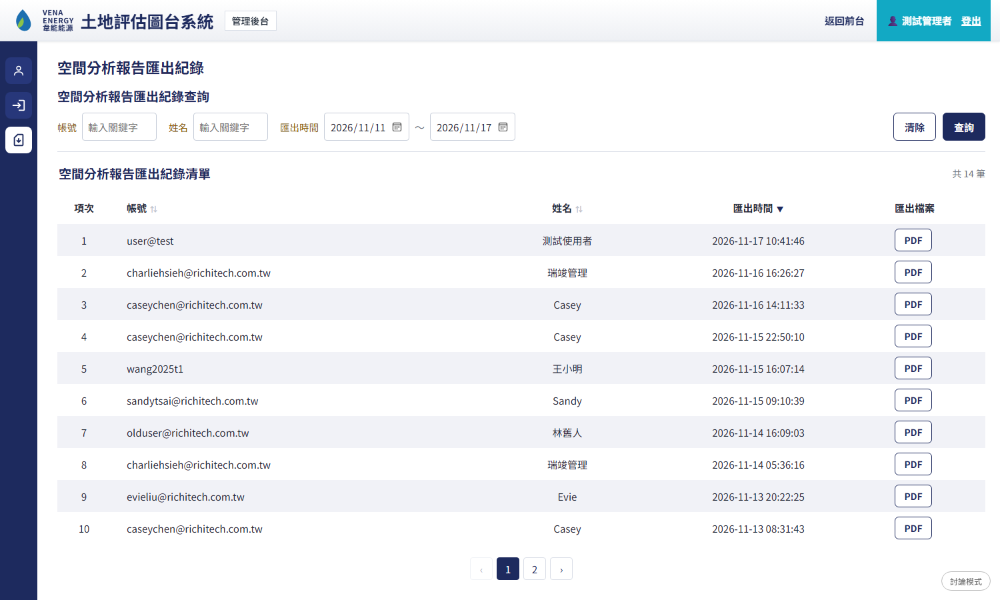
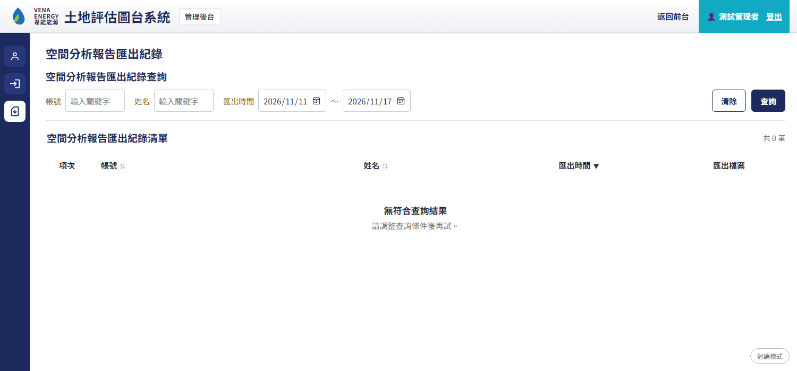
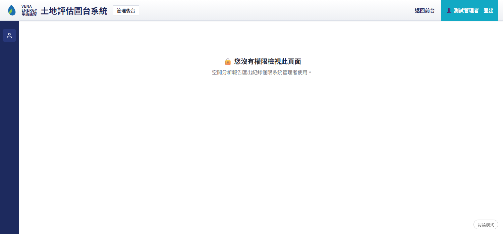

# 空間分析報告匯出紀錄 需求規格 v1
> 依據雛型：[02_雛型/雛型_v1_後台_資料下載紀錄.html](../02_雛型/雛型_v1_後台_資料下載紀錄.html)（2026-10-22）｜上游：[01_需求整理/](../01_需求整理/01_需求摘要.md)
> 狀態：草稿（Q-01、02、03、05、06 已確認；尚待 Q-04 每頁筆數與效能；Q-13 已確認）｜PM：evieliu@richitech.com.tw｜對應合約：增補協議項次 3.2（與 3.1 合計 NT$110,000）

相關連結（claude.ai）：[可點雛型 v1](https://claude.ai/artifact/1MmF5tf2Cm3nwJM6Y2MKYm)｜[Design 畫布](https://claude.ai/artifact/59RkyU3w46mFKiyjNeTckh)｜[設計交付](https://claude.ai/artifact/KhnkfFAWxMZZugqcDLsYUS)｜[圖文對照版](https://claude.ai/artifact/PXfeBXkE2PuHB52X8pQSDP)

## 版本紀錄
| 版本 | 日期 | 依據雛型 | 主要異動 |
|------|------|----------|----------|
| v1 | 2026-10-22 | v1 | 首次產出。F-04（重新匯出當時 PDF）為 ⚠️ 暫定，待技術確認做法與合約判定 |
| v1 | 2026-10-30 | v1（原地調整，尚未對外） | 【更新 2026-10-30】「使用者姓名」統一改為「姓名」；匯出時間預設近 7 天；清單帳號欄靠左對齊（影響 3.2 欄位表、BR-09、AC-03、19、20、23、47，新增 AC-48～50、Q-06） |
| v1 | 2026-10-30 | v1（原地調整，尚未對外） | 【更新 2026-10-30】技術確認 PDF 於匯出時儲存成檔、點「匯出」直接調用、不即時重新產生：Q-02 結案，AC-29、30、32 不再待確認（影響 3.2 欄位表、BR-04、五、附錄 B） |
| v1 | 2026-10-30 | v1（原地調整，尚未對外） | 【更新 2026-10-30】PM 確認：Q-01 成功匯出才記；Q-05「重新匯出」屬合約內、不追加報價（F-04 不再暫定）；Q-06 近 7 天含今天共 7 天、「清除」回到預設；原檔儲存空間目前應無問題、會再與客戶確認（併入 Q-03）（影響 BR-03、BR-09、AC-11、37、40、48、附錄 B） |
| v1 | 2026-11-13 | v1（原地調整，尚未對外） | 【更新 2026-11-13】客戶確認：只記空間分析 PDF（2026-11-05 擴大範圍的討論版 v2 撤回）；清單「匯出 PDF」欄改稱「匯出檔案」、按鈕文字改為「PDF」、靠左對齊；查詢條件整組換行；匯出紀錄完整保留、PDF 只保留近 1 年，逾 1 年不提供匯出（Q-03 結案；影響 3.2 欄位表、BR-04、BR-06、3.3、五、AC-03、29～34、36、40、47，新增 BR-11、AC-51、52、Q-13） |
| v1 | 2026-11-13 | v1（原地調整，尚未對外） | 【更新 2026-11-13】客戶確認：①PDF 逾 1 年以匯出日期起算，到期日（1 年後同月同日）當天仍可匯出，隔天起不提供，逾期 PDF 由系統自動刪除，排程時間點由技術安排（Q-13 結案）；②匯出時間區間沒有上限（Q-04 剩每頁筆數與效能）；AC-52 改寫，新增 AC-53、54 |
| v1 | 2026-11-25 | v1（原地調整，尚未對外） | 【更新 2026-11-25】PM 決定：逾 1 年的列「匯出檔案」欄改顯示淡色「-」，取代原「已逾 1 年」文字（影響 3.2 欄位表、BR-11、3.3 例外表、AC-40、51、53） |

## 一、功能概述
在土地評估圖台系統「管理後台」新增「空間分析報告匯出紀錄」頁，讓系統管理者查看前台使用者每次匯出「進階匯出成果 PDF」（空間分析匯出）的帳號、姓名與匯出時間，並可在紀錄上重新匯出當時那份 PDF（內容與當時完全一致）。紀錄唯讀，不可編輯、不可刪除。

- User Story：身為系統管理者，我要在後台查看誰在何時匯出了成果 PDF，並用帳號、姓名、匯出時間篩選，以便稽核資料使用情形。
- User Story：身為系統管理者，我要在紀錄上重新匯出當時那份 PDF，以便事後調閱與當時完全一致的內容。

## 二、畫面清單
| # | 畫面 | 雛型檔案 | 截圖 | 用途 |
|---|------|----------|------|------|
| 1 | 後台・空間分析報告匯出紀錄（有資料） | 雛型_v1_後台_資料下載紀錄.html | 畫面截圖/v1_後台_資料下載紀錄_清單.png | 查詢條件＋清單＋PDF 按鈕＋分頁 |
| 2 | 後台・空間分析報告匯出紀錄（無符合查詢結果） | 同上（`?state=empty`） | 畫面截圖/v1_後台_資料下載紀錄_尚無紀錄.png | 非理想狀態 |
| 3 | 後台・空間分析報告匯出紀錄（無權限） | 同上（`?state=noperm`） | 畫面截圖/v1_後台_資料下載紀錄_無權限.png | 非系統管理者直接進入網址 |

## 三、畫面規格

### 3.1 左側選單入口（F-01）
- 後台左側圖示列，在「登入紀錄」按鈕下方新增「空間分析報告匯出紀錄」按鈕（滑鼠移上顯示提示文字「空間分析報告匯出紀錄」）；圖示使用 Material Icons Outlined 的 sim_card_download（24px，顏色隨按鈕：目前頁為深藍、其餘為白）；「登入紀錄」按鈕沿用登入紀錄功能的 Material Icons Outlined「login」圖示；滑鼠移上（或鍵盤聚焦）時在按鈕右側立即顯示深色提示框，文字為按鈕名稱，三顆按鈕皆同；目前所在頁的按鈕為白底，其餘為深藍底。【更新 2026-10-30】
- 只有角色為「系統管理者」才顯示此按鈕。
- 說明：左側列目前有三顆按鈕（帳號管理、登入紀錄、空間分析報告匯出紀錄）。登入紀錄雛型的左側列只有兩顆，上線時兩功能的選單需一致。

### 3.2 空間分析報告匯出紀錄頁（F-02、F-03、F-04）

頁面由上而下：頁面標題「空間分析報告匯出紀錄」→「空間分析報告匯出紀錄查詢」區 → 分隔線 →「空間分析報告匯出紀錄清單」區（右上角「共 N 筆」）→ 分頁。

**欄位表（查詢條件）**
| 元素 | 欄位名 | 型別 | 必填 | 驗證規則 | 預設值 | 資料來源 | 互動行為 | F-編號 |
|------|--------|------|------|----------|--------|----------|----------|--------|
| 文字框 | 帳號 | 文字 | 否 | 無長度限制（【需 PG 確認】上限） | 空，提示「輸入關鍵字」 | 使用者輸入 | 包含比對，不分大小寫 | F-03 |
| 文字框 | 姓名 | 文字 | 否 | 同上 | 空，提示「輸入關鍵字」 | 使用者輸入 | 包含比對，不分大小寫 | F-03 |
| 日期選擇 | 匯出時間（起） | 日期 yyyy-MM-dd | 否 | 起日不可晚於迄日；區間沒有上限【客戶確認 2026-11-13】 | 近 7 天：今天往前 6 天【更新 2026-10-30】 | 使用者選擇 | 比對 起日 00:00:00 起 | F-03 |
| 日期選擇 | 匯出時間（迄） | 日期 yyyy-MM-dd | 否 | 同上 | 今天【更新 2026-10-30】 | 使用者選擇 | 比對 迄日 23:59:59 止；可只填一端；手動清空即不限 | F-03 |
| 按鈕 | 查詢 | — | — | — | — | — | 套用條件、回第 1 頁、保留目前排序 | F-03 |
| 按鈕 | 清除 | — | — | — | — | — | 帳號、姓名清空，匯出時間回到預設近 7 天，並重新查詢，回第 1 頁【更新 2026-10-30】 | F-03 |

**欄位表（清單）**
| 元素 | 欄位名 | 型別 | 必填 | 驗證規則 | 預設值 | 資料來源 | 互動行為 | F-編號 |
|------|--------|------|------|----------|--------|----------|----------|--------|
| 欄 | 項次 | 整數 | — | — | — | 依目前排序與頁碼連續編號（第 2 頁從 11 起） | 不可排序 | F-02 |
| 欄 | 帳號 | 文字 | — | — | — | 匯出當下的帳號（寫入時存快照） | 可排序；表頭與內容靠左對齊（其餘欄維持置中）；介面不標示帳號目前是否仍存在或已被刪除【更新 2026-10-30】 | F-02 |
| 欄 | 姓名 | 文字 | — | — | — | 匯出當下該帳號的姓名（快照） | 可排序 | F-02 |
| 欄 | 匯出時間 | 日期時間 yyyy-MM-dd HH:mm:ss | — | — | 預設排序欄，新到舊 | 系統時間（寫入時）【技術確認 2026-10-30：成功匯出才記，以成功匯出時間為準】 | 可排序 | F-02 |
| 欄 | 匯出檔案 | 按鈕「PDF」 | — | — | — | 匯出時已儲存的 PDF 檔，點擊直接調用，不重新產生【技術確認 2026-10-30】 | 表頭與內容靠左對齊；不可排序；點擊後取得與當時完全一致的 PDF；介面任何位置不顯示檔名；此動作不另記一筆；匯出時間超過 1 年者不顯示按鈕，改顯示淡色「-」【客戶確認 2026-11-13】 | F-04 |
| 分頁 | 頁碼 | — | — | — | 第 1 頁、每頁 10 筆【待定 Q-04】 | — | 上一頁／各頁碼／下一頁；第 1 頁時上一頁停用、最後一頁時下一頁停用；目前頁為深藍底 | F-02 |

**業務規則**
- BR-01（F-01）：「空間分析報告匯出紀錄」入口與頁面只開放角色為系統管理者；其他角色即使直接輸入網址也不可看到內容（顯示 3.3 無權限頁，且後端清單 API 與 PDF 匯出 API 都要拒絕，【需 PG 確認】）。
- BR-02（F-05）：只記錄「進階匯出成果」（空間分析匯出）產出的 PDF。kml、競合分析表格匯出等其他匯出不納入。
- BR-03（F-02）：每次 PDF 成功匯出寫入一筆紀錄；匯出失敗或沒有取得檔案不留紀錄【技術確認 2026-10-30】。寫入當下保存帳號、姓名與該份 PDF；之後帳號被刪除、改名、停用，都不影響既有紀錄與 PDF。
- BR-04（F-04）：PDF 於匯出時即儲存成檔案，點「PDF」直接調用該檔，不即時重新產生，因此取得的檔案與該筆當時匯出的內容完全一致，不受之後圖層資料更新影響。儲存空間、備份與保存期限併入 Q-03【技術確認 2026-10-30】。
- BR-05（F-04）：管理者在本頁重新匯出，不新增紀錄、「共 N 筆」不變。
- BR-06（F-02）：紀錄唯讀，畫面沒有新增、修改、刪除功能；匯出紀錄完整保留，不自動清除【客戶確認 2026-11-13】。
- BR-07（F-02）：預設依匯出時間由新到舊。點可排序欄位標題切換排序：第一次點「匯出時間」為由新到舊，其餘欄位為升冪（A→Z）；再點同欄反向。切換排序後回第 1 頁。排序套用在整份查詢結果，不是只排目前頁。
- BR-08（F-03）：多個條件同時成立才列出（AND）；條件為空表示不限。
- BR-09（F-03）：進入頁面時匯出時間自動帶入近 7 天（迄日為今天、起日為今天往前 6 天，含今天共 7 天）並依此查詢；使用者可修改，手動清空起訖日期表示不限。區間含起日與迄日當天；只填起日表示該日起至今，只填迄日表示至該日止。「近 7 天」含今天共 7 天；按「清除」回到預設近 7 天【PM 確認 2026-10-30】。
- BR-10（F-02）：「共 N 筆」為符合條件的總筆數，不隨頁碼變動。
- BR-11（F-04）：PDF 只保留近 1 年。匯出時間超過 1 年的紀錄仍照常顯示（帳號、姓名、匯出時間都在，計入「共 N 筆」），但該筆 PDF 後台不提供匯出，「匯出檔案」欄改顯示淡色「-」（不是按鈕、不可點，滑鼠移上提示「PDF 已超過 1 年保存期限，後台不提供匯出」）。「超過 1 年」以匯出日期起算：到期日為匯出日期 1 年後的同月同日，到期日當天仍可匯出，隔天起不提供；逾期的 PDF 檔由系統自動刪除，排程時間點由技術安排，排程執行前也依此規則顯示「-」【客戶確認 2026-11-13】。

### 3.3 非理想狀態

**例外流程與錯誤訊息**
| 情境 | 系統行為 | 訊息文字（實際文案） |
|------|----------|----------------------|
| 查詢條件下無符合資料 | 表格區顯示提示，「共 0 筆」，不顯示分頁 | 「無符合查詢結果」＋「請調整查詢條件後再試。」 |
| 系統尚無任何紀錄 | 同上 | 「無符合查詢結果」＋「請調整查詢條件後再試。」 |
| 起日晚於迄日按「查詢」 | 不送出查詢，清單維持原樣，條件列下方顯示紅字 | 「匯出時間的起日不可晚於迄日」 |
| 非系統管理者進入頁面 | 不顯示查詢與清單，頁面中央顯示提示 | 「🔒 您沒有權限檢視此頁面」＋「空間分析報告匯出紀錄僅限系統管理者使用。」 |
| PDF 已超過 1 年保存期限 | 該筆「匯出檔案」欄顯示淡色「-」，沒有按鈕、不可點擊；其餘欄位照常顯示 | 「-」（滑鼠移上提示：「PDF 已超過 1 年保存期限，後台不提供匯出」） |
| PDF 因其他原因取不到（未逾期） | 【待定】隨技術確認一併決定 | 【待定】 |

> 以上文案為雛型暫定文案【待 PM 審閱】，沿用登入紀錄的句型；既有後台未提供可沿用的對應訊息。

## 四、權限與資料範圍
| 角色 | 可用操作 | 資料範圍 |
|------|----------|----------|
| 系統管理者 | 看到左側入口；查詢、排序、分頁、匯出 PDF | 全部帳號的匯出紀錄與 PDF（含已刪除帳號） |
| 一般使用者 | 無（看不到入口，直接進網址顯示無權限頁，API 拒絕） | 無 |

## 五、非功能需求
- 紀錄與留存 PDF 持續累積：清單必須分頁；查詢與排序的效能要求【待定，需技術主管確認 Q-04】。
- 匯出紀錄完整保留不清除；PDF 只保留近 1 年（客戶確認 2026-11-13），儲存空間以近 1 年估算，技術評估目前應無問題，會再與客戶確認。逾 1 年（匯出日期 1 年後的次日起）的 PDF 由系統自動刪除，排程時間點由技術安排，不影響匯出紀錄。
- 匯出時間以伺服器時間記錄，顯示格式 yyyy-MM-dd HH:mm:ss（西元年，沿用登入紀錄【待 PM 確認】）。
- PDF 可能含敏感的土地評估成果，僅限系統管理者取得（BR-01）。

## 六、驗收條件（AC）— PG 自測與 PM 驗收共用
> PG 交付前逐項自測勾「PG自測」，全勾才交 PM；PM 驗收勾「PM驗收」。
> 不通過的在備註寫清楚現象：是 bug → PG 修復後複測；是需求認知差異或客戶改需求 → 回 /req-intake 從雛型改起。
> Q-01、Q-02、Q-03、Q-05、Q-06 已確認，目前沒有待確認的 AC；標【待定】的 AC（AC-46）待結論補上。

| AC | 類別 | 對應 F | Given（前置） | When（操作） | Then（預期結果） | PG自測 | PM驗收 | 備註 |
|----|------|--------|---------------|--------------|------------------|--------|--------|------|
| AC-01 | 主流程 | F-01 | 以系統管理者登入後台 | 查看左側圖示列 | 「登入紀錄」下方有「空間分析報告匯出紀錄」按鈕，滑鼠移上顯示「空間分析報告匯出紀錄」 | ☐ | ☐ | |
| AC-02 | 主流程 | F-01 | 同 AC-01 | 點「空間分析報告匯出紀錄」按鈕 | 進入空間分析報告匯出紀錄頁，標題為「空間分析報告匯出紀錄」，該按鈕為白底 | ☐ | ☐ | |
| AC-03 | 主流程 | F-02 | 系統近 7 天內已有 25 筆匯出紀錄，進入空間分析報告匯出紀錄頁 | 查看清單 | 欄位依序為項次、帳號、姓名、匯出時間、匯出檔案；右上顯示「共 25 筆」 | ☐ | ☐ | |
| AC-04 | 主流程 | F-02 | 同 AC-03 | 查看第 1 頁 | 顯示 10 筆，匯出時間最新的在最上方，項次 1～10 | ☐ | ☐ | |
| AC-05 | 主流程 | F-02 | 同 AC-03 | 點頁碼「2」 | 顯示第 11～20 筆，項次為 11～20，頁碼 2 為深藍底 | ☐ | ☐ | |
| AC-06 | 主流程 | F-02 | 同 AC-03 | 點頁碼「3」 | 顯示 5 筆（項次 21～25），「下一頁」按鈕停用 | ☐ | ☐ | |
| AC-07 | 主流程 | F-02 | 目前在第 1 頁 | 查看「上一頁」 | 按鈕停用，不可點擊 | ☐ | ☐ | |
| AC-08 | 主流程 | F-02 | 帳號 user@test 於 2026-10-22 14:20:41 在前台匯出 PDF | 進入空間分析報告匯出紀錄頁查看該筆 | 匯出時間顯示「2026-10-22 14:20:41」，帳號與姓名與匯出當時一致 | ☐ | ☐ | |
| AC-09 | 主流程 | F-02 | 帳號「olduser@richitech.com.tw」曾匯出過 PDF，之後被管理者從帳號管理刪除 | 進入空間分析報告匯出紀錄頁查看該帳號的紀錄 | 紀錄仍在，帳號欄顯示「olduser@richitech.com.tw」、姓名為當時的姓名，後面沒有任何「已刪除」之類的標示 | ☐ | ☐ | |
| AC-10 | 主流程 | F-02 | 帳號「Evie」匯出後，其姓名被改為「Evie L」 | 查看匯出前產生的舊紀錄 | 舊紀錄姓名仍顯示「Evie」，新紀錄顯示「Evie L」 | ☐ | ☐ | |
| AC-11 | 主流程 | F-02、F-05 | 一般使用者在前台完成空間分析並匯出 PDF，匯出成功 | 以系統管理者開空間分析報告匯出紀錄頁並重新查詢 | 新增一筆該帳號的紀錄，匯出時間與實際匯出時間相差不超過 1 分鐘 | ☐ | ☐ | 技術已確認 2026-10-30：成功匯出才記 |
| AC-12 | 主流程 | F-02 | 進入空間分析報告匯出紀錄頁 | 查看清單與頁面 | 沒有新增、修改、刪除的按鈕或連結 | ☐ | ☐ | |
| AC-13 | 主流程 | F-02 | 預設排序（匯出時間 ▼） | 點「匯出時間」標題 | 改為由舊到新，標題箭頭變 ▲，回第 1 頁 | ☐ | ☐ | |
| AC-14 | 主流程 | F-02 | 預設排序 | 點「帳號」標題 | 依帳號升冪（A→Z）排序，再點一次改降冪；回第 1 頁 | ☐ | ☐ | |
| AC-15 | 主流程 | F-02 | 目前在第 2 頁 | 點「姓名」標題 | 跨所有頁依姓名排序，並回到第 1 頁 | ☐ | ☐ | |
| AC-16 | 主流程 | F-03 | 清單有帳號 AlvinLin@richitech.com.tw | 帳號欄輸入「alvin」按「查詢」 | 只列出帳號含 alvin（不分大小寫）的紀錄，含 AlvinLin@richitech.com.tw | ☐ | ☐ | |
| AC-17 | 主流程 | F-03 | 清單有姓名「王小明」的紀錄 | 姓名欄輸入「小明」按「查詢」 | 只列出姓名含「小明」的紀錄 | ☐ | ☐ | |
| AC-18 | 主流程 | F-03 | 清單有 2026-10-21 與 2026-10-22 的紀錄 | 匯出時間選 2026-10-22～2026-10-22 按「查詢」 | 只列出 10-22 當天 00:00:00～23:59:59 的紀錄；10-21 23:59:59 的不在 | ☐ | ☐ | |
| AC-19 | 主流程 | F-03 | 同 AC-18 | 清空迄日欄位，只選起日 2026-10-22 按「查詢」 | 列出 10-22 起（含當天）的所有紀錄 | ☐ | ☐ | |
| AC-20 | 主流程 | F-03 | 同 AC-18 | 清空起日欄位，只選迄日 2026-10-21 按「查詢」 | 列出至 10-21 當天 23:59:59 止的所有紀錄 | ☐ | ☐ | |
| AC-21 | 主流程 | F-03 | 清單有帳號 Evie 於 10-22 的紀錄 | 帳號輸入「evie」並選日期 10-22～10-22 按「查詢」 | 只列出同時符合兩條件的紀錄（AND） | ☐ | ☐ | |
| AC-22 | 主流程 | F-03 | 已輸入條件並查詢，目前在第 3 頁 | 按「查詢」 | 回到第 1 頁 | ☐ | ☐ | |
| AC-23 | 主流程 | F-03 | 已輸入帳號條件，並把匯出時間改為 2026-10-01～2026-10-05 後查詢 | 按「清除」 | 帳號、姓名清空，匯出時間回到近 7 天（今天為 2026-10-30 時為 2026-10-24～2026-10-30），清單以此區間重新查詢，回第 1 頁 | ☐ | ☐ | |
| AC-24 | 主流程 | F-03 | 已依匯出時間由舊到新排序 | 輸入帳號條件按「查詢」 | 結果仍保持由舊到新排序 | ☐ | ☐ | |
| AC-25 | 驗證 | F-03 | 進入空間分析報告匯出紀錄頁 | 起日選 2026-10-23、迄日選 2026-10-22，按「查詢」 | 清單不變，條件列下方顯示紅字「匯出時間的起日不可晚於迄日」 | ☐ | ☐ | |
| AC-26 | 驗證 | F-03 | AC-25 的錯誤訊息顯示中 | 把迄日改為 2026-10-23 再按「查詢」 | 錯誤訊息消失，正常查詢 | ☐ | ☐ | |
| AC-27 | 驗證 | F-03 | 進入空間分析報告匯出紀錄頁 | 帳號欄輸入「%」或「'」按「查詢」 | 視為一般文字比對，不報錯、不外洩全部資料（無符合時顯示「無符合查詢結果」） | ☐ | ☐ | SQL 與萬用字元防護 |
| AC-28 | 驗證 | F-03 | 進入空間分析報告匯出紀錄頁 | 帳號欄輸入前後有空白的「 alvin 」按「查詢」 | 前後空白不影響結果，等同輸入「alvin」 | ☐ | ☐ | |
| AC-29 | 主流程 | F-04 | 清單有一筆帳號 user@test 於 2026-10-22 14:20:41 匯出的紀錄 | 點該筆「匯出檔案」欄的「PDF」 | 瀏覽器匯出一份 PDF，用 PDF 閱讀器可正常開啟，內容與當時前台匯出的那份相同 | ☐ | ☐ | 技術已確認 2026-10-30：存檔直接調用 |
| AC-30 | 主流程 | F-04 | 某筆紀錄的 PDF 匯出後，該分析範圍的圖層資料已更新，現在重新產出的內容與當時不同 | 點該筆「PDF」 | 取得的仍是當時那份 PDF（檔案內容與當時完全一致，可用檔案雜湊值比對），不是以現行資料重新產生的 | ☐ | ☐ | 技術已確認 2026-10-30：存檔直接調用 |
| AC-31 | 主流程 | F-04 | 清單「共 25 筆」 | 管理者點任一筆「PDF」，匯出完成後重新查詢 | 「共 25 筆」不變，沒有新增管理者重新匯出的紀錄 | ☐ | ☐ | |
| AC-32 | 主流程 | F-04 | AC-09 的已刪除帳號紀錄 | 點該筆「PDF」 | 仍可取得當時那份 PDF | ☐ | ☐ | 技術已確認 2026-10-30：存檔直接調用 |
| AC-33 | 主流程 | F-04 | 進入空間分析報告匯出紀錄頁 | 檢視整頁任何位置（含滑鼠移上按鈕） | 介面不出現 PDF 檔名；按鈕文字固定為「PDF」 | ☐ | ☐ | 匯出到本機的實際檔名由技術決定【待定】 |
| AC-34 | 主流程 | F-04 | 進入空間分析報告匯出紀錄頁 | 點「匯出檔案」欄標題 | 無反應，標題旁沒有排序箭頭 | ☐ | ☐ | |
| AC-35 | 主流程 | F-05 | 一般使用者在前台做 kml 匯出、競合分析表格匯出（若該功能已上線） | 以系統管理者重新查詢空間分析報告匯出紀錄 | 紀錄筆數不變，沒有新增這些匯出的紀錄 | ☐ | ☐ | 只記進階匯出成果 PDF |
| AC-36 | 主流程 | F-05、F-04 | 同一使用者在 10 分鐘內匯出兩次不同範圍的 PDF | 以系統管理者查看 | 出現兩筆紀錄，各自的「PDF」取得各自對應的那份 PDF，不會互相對調 | ☐ | ☐ | |
| AC-37 | 例外 | F-05 | 使用者匯出 PDF 時發生錯誤、沒有取得檔案 | 以系統管理者重新查詢 | 沒有新增紀錄（匯出失敗、沒有取得檔案不記） | ☐ | ☐ | 技術已確認 2026-10-30：成功匯出才記 |
| AC-38 | 例外 | F-03 | 清單有資料 | 帳號輸入「zzzzzz」按「查詢」 | 表格區顯示「無符合查詢結果」與「請調整查詢條件後再試。」，右上「共 0 筆」，不顯示分頁 | ☐ | ☐ | |
| AC-39 | 例外 | F-02 | 系統尚無任何匯出紀錄 | 進入空間分析報告匯出紀錄頁 | 表格區顯示「無符合查詢結果」與「請調整查詢條件後再試。」，右上「共 0 筆」 | ☐ | ☐ | |
| AC-40 | 例外 | F-04 | 某筆紀錄的匯出時間已超過 1 年 | 查看該筆「匯出檔案」欄 | 顯示淡色「-」，沒有 PDF 按鈕，不可點擊；滑鼠移上提示「PDF 已超過 1 年保存期限，後台不提供匯出」；該筆其他欄位照常顯示 | ☐ | ☐ | 客戶確認 2026-11-13 |
| AC-41 | 權限 | F-01 | 以一般使用者登入 | 查看後台左側圖示列（若可進入後台） | 沒有「空間分析報告匯出紀錄」按鈕 | ☐ | ☐ | 一般使用者能否進後台以現行系統為準 |
| AC-42 | 權限 | F-01 | 以一般使用者登入 | 直接輸入空間分析報告匯出紀錄頁網址 | 不顯示任何查詢與紀錄，頁面顯示「🔒 您沒有權限檢視此頁面」與「空間分析報告匯出紀錄僅限系統管理者使用。」 | ☐ | ☐ | |
| AC-43 | 權限 | F-01 | 以一般使用者登入，取得空間分析報告匯出紀錄清單 API 的位址 | 直接呼叫該 API | 回覆拒絕（無權限），不回傳任何紀錄 | ☐ | ☐ | 【需 PG 確認】API 路徑 |
| AC-44 | 權限 | F-04 | 以一般使用者登入，取得某筆 PDF 的匯出位址（例如他人的匯出識別碼） | 直接呼叫 PDF 匯出 API | 回覆拒絕（無權限），不回傳任何檔案 | ☐ | ☐ | 防止直接輸入網址取得他人 PDF |
| AC-45 | 權限 | F-01 | 未登入 | 直接輸入空間分析報告匯出紀錄頁網址 | 導向登入頁，不顯示紀錄 | ☐ | ☐ | 沿用現有後台未登入行為 |
| AC-46 | 非功能 | F-02 | 系統有 10,000 筆匯出紀錄 | 進入空間分析報告匯出紀錄頁並翻頁、查詢 | 回應時間要求待技術主管確認後補上 | ☐ | ☐ | 【待定 Q-04】 |
| AC-47 | 非功能 | F-02、F-04 | 系統中有 1 年前的匯出紀錄 | 清空匯出時間起訖日期後查詢 | 該紀錄仍在清單且計入「共 N 筆」；其 PDF 不提供匯出（見 AC-40） | ☐ | ☐ | 客戶確認 2026-11-13：紀錄完整保留 |
| AC-51 | 主流程 | F-04 | 兩筆紀錄：一筆匯出時間在 1 年內、一筆超過 1 年 | 清空匯出時間起訖日期後查詢 | 1 年內那筆「匯出檔案」欄是「PDF」按鈕，超過 1 年那筆顯示「-」 | ☐ | ☐ | |
| AC-52 | 主流程 | F-04 | 今天為 2026-11-13，有一筆匯出時間為 2025-11-13（剛好滿 1 年）的紀錄 | 清空匯出時間起訖日期後查看該筆「匯出檔案」欄 | 顯示「PDF」按鈕（到期日當天仍可匯出） | ☐ | ☐ | 客戶確認 2026-11-13 |
| AC-53 | 主流程 | F-04 | 同 AC-52 那筆紀錄，今天為 2026-11-14 | 查看該筆「匯出檔案」欄 | 顯示淡色「-」，沒有按鈕（到期日隔天起不提供） | ☐ | ☐ | 客戶確認 2026-11-13 |
| AC-54 | 主流程 | F-03 | 系統有跨 3 年的匯出紀錄 | 匯出時間起日選 3 年前、迄日選今天，按「查詢」 | 正常列出區間內所有紀錄，不出現區間上限的提示或錯誤訊息 | ☐ | ☐ | 客戶確認 2026-11-13：區間沒有上限 |
| AC-48 | 主流程 | F-03 | 今天為 2026-10-30，系統有 10-23、10-24、10-30 的紀錄 | 進入空間分析報告匯出紀錄頁，不做任何操作 | 匯出時間起日顯示 2026-10-24、迄日顯示 2026-10-30，清單已依此區間列出 10-24 與 10-30 的紀錄，10-23 的不列；右上「共 N 筆」為區間內筆數 | ☐ | ☐ | 近 7 天含今天共 7 天（PM 確認 2026-10-30） |
| AC-49 | 主流程 | F-03 | 同 AC-48 | 清空起日與迄日按「查詢」 | 列出全部紀錄（不限區間），含 10-23 | ☐ | ☐ | |
| AC-50 | 主流程 | F-03 | 今天為 2026-10-30，系統有 2026-10-23 23:59:59 與 2026-10-24 00:00:00 的紀錄 | 進入空間分析報告匯出紀錄頁（預設近 7 天） | 10-24 00:00:00 的紀錄列出，10-23 23:59:59 的不列 | ☐ | ☐ | 起日邊界 |

**驗收彙總**：總測項 54（【待定】1 項）｜通過 __｜不通過 __

## 七、追溯表
| F-編號 | 畫面 | 規格章節 | AC |
|--------|------|----------|-----|
| F-01 | 左側選單、無權限頁 | 3.1、3.3、四、BR-01 | AC-01、02、41～45 |
| F-02 | 空間分析報告匯出紀錄頁（清單、分頁、排序）、尚無紀錄 | 3.2、3.3、BR-03、06、07、10 | AC-03～15、39、46、47 |
| F-03 | 空間分析報告匯出紀錄頁（查詢條件） | 3.2、BR-08、09 | AC-16～28、38、48～50、54 |
| F-04 | 空間分析報告匯出紀錄頁（匯出檔案欄的 PDF 按鈕） | 3.2、BR-04、05、11 | AC-29～34、36、40、44、47、51～53 |
| F-05 | 無獨立畫面（紀錄範圍規則） | BR-02、03 | AC-11、35～37 |
| 非功能 | — | 五 | AC-46、47 |

## 附錄
### A. 一致性檢查結果（2026-10-22）
| # | 項目 | 結果 | 建議 |
|---|------|------|------|
| 1 | 需求摘要 F-01～F-05 是否都在雛型出現 | ✅ F-01～F-04 有畫面；F-05 無獨立畫面，寫在雛型 SPEC 業務規則 | — |
| 2 | 雛型有、需求摘要沒有的元素 | ⚠️ 「項次」欄、分頁元件、排序箭頭、無權限頁與各錯誤文案是 AI 依 PM 決定與登入紀錄慣例補出的 | 請 PM 確認是否接受（文案見 3.3） |
| 3 | 每頁筆數 | ⚠️ 雛型暫設 10 筆，帳號管理截圖未見實際分頁設定 | 規格暫採 10 筆【待定 Q-04】 |
| 4 | 日期時間顯示格式 | ⚠️ 既有後台沒有日期欄可對照，雛型用西元 yyyy-MM-dd HH:mm:ss | 請 PM 確認是否要用民國年（與登入紀錄一致即可） |
| 5 | 每個 F 是否有 AC | ✅ F-01～F-05 皆有；效能 AC-46 因指標待定而留白 | — |
| 6 | 欄位與畫面是否一致 | ✅ 欄位名稱與雛型相同 | — |
| 7 | 需求摘要排除項（非 PDF 匯出、匯出紀錄清單、手動刪除、一般使用者查詢、管理者重新匯出另記一筆） | ✅ 規格與雛型皆未含 | — |
| 8 | 與登入紀錄的左側選單一致性 | ⚠️ 登入紀錄雛型左側列只有兩顆按鈕，缺空間分析報告匯出紀錄入口 | 兩份雛型上線前對齊；本規格以三顆按鈕為準 |
| 9 | 雛型 `?spec=1` 的「PDF 因其他原因取不到（未逾期）」為 TODO | ✅ 逾 1 年已定案（AC-40）；其他原因仍待定 | 隨技術確認補上 |

### B. 待定清單
| 編號 | 項目 | 標記 | 決策者 |
|------|------|------|--------|
| Q-01 | 何時算一筆：成功匯出才記；匯出失敗或沒有取得檔案不留紀錄 | 【已確認 2026-10-30】 | 技術主管 |
| Q-02 | 「與當時完全一致」的做法：PDF 於匯出時儲存成檔、點「PDF」直接調用，不即時產生（儲存空間與備份併入 Q-03） | 【已確認 2026-10-30】 | 技術主管 |
| Q-03 | 紀錄與 PDF 的保存期限：匯出紀錄完整保留不清除；PDF 只保留近 1 年，超過 1 年的 PDF 後台不提供匯出（儲存空間目前評估應無問題，會再與客戶確認） | 【已確認 2026-11-13】 | 客戶 |
| Q-04 | 每頁筆數、查詢與排序效能指標（匯出時間區間不設上限，客戶確認 2026-11-13） | 【待定】 | PM／技術主管 |
| Q-13 | 「超過 1 年」的算法與清除方式：以匯出日期起算，到期日為 1 年後同月同日，到期日當天仍可匯出、隔天起不提供；逾期 PDF 由系統自動刪除，排程時間點由技術安排 | 【已確認 2026-11-13】 | 客戶 |
| Q-06 | 匯出時間預設「近 7 天」含今天共 7 天；按「清除」回到預設近 7 天 | 【已確認 2026-10-30】 | PM |
| Q-05 | 「可再次匯出當時的檔案」是否算在合約 3.2 內：PM 確認算合約內，不追加報價（見 [合約判定](../01_需求整理/確認紀錄/合約判定_重新下載當時PDF.md)） | 【已確認 2026-10-30】 | PM |
| — | PDF 匯出到本機的實際檔名 | 【待定】 | PM／技術主管 |
| — | 帳號／姓名輸入長度上限 | 【需 PG 確認】 | PG |
| — | 一般使用者能否進入後台、清單 API 與 PDF 匯出 API 的權限驗證方式 | 【需 PG 確認】 | PG |
